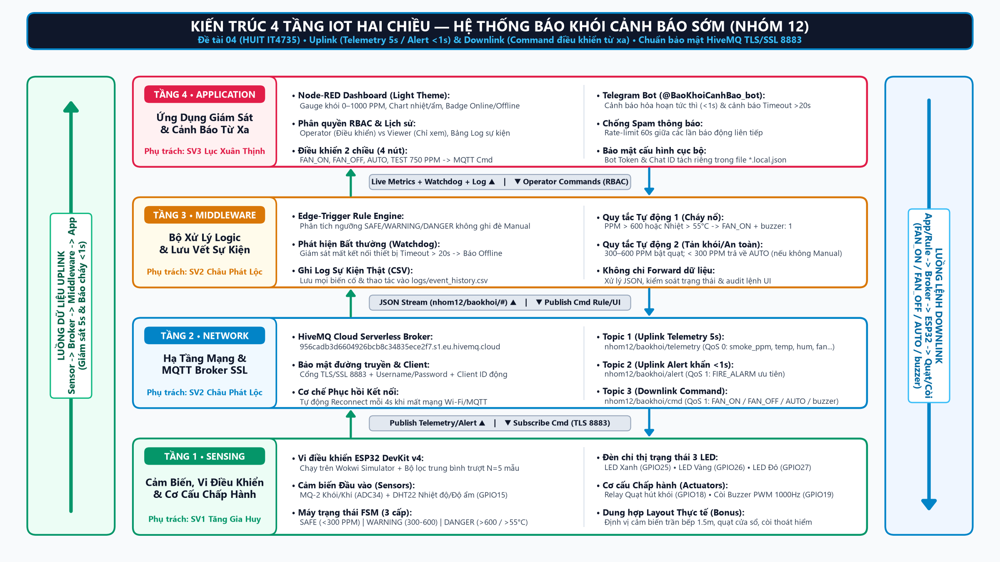

# ĐỒ ÁN MÔN HỌC IOT (IT4735) - NHÓM 12
## ĐỀ TÀI 04: HỆ THỐNG BÁO KHÓI CẢNH BÁO SỚM (EARLY FIRE & SMOKE DETECTION SYSTEM)

> **Trường Đại học Công Thương TP.HCM (HUIT)**  
> **Khoa Công nghệ Thông tin - Bộ môn Kỹ thuật Mạng & IoT**  
> **Giảng viên hướng dẫn:** Thầy Võ Hoàng Hải  
> **Tiêu chuẩn đồ án:** 10 tuần / Tối thiểu 60 giờ mỗi sinh viên / Đáp ứng trọn vẹn Rubric 100 điểm (+5 điểm Bonus Layout/Hardware).

---

## 👥 THÀNH VIÊN NHÓM 12 & PHÂN CÔNG VAI TRÒ

| STT | Họ và Tên | MSSV | Vai trò chính | Nhiệm vụ đảm trách |
| :---: | :--- | :---: | :--- | :--- |
| 1 | **Lục Xuân Thịnh** | **2001230931** | **Trưởng nhóm (Lead) • SV3** | Kiến trúc hệ thống, Tầng 4 (Dashboard Light Theme, RBAC & Telegram Bot), Tích hợp E2E & Tài liệu |
| 2 | **Châu Phát Lộc** | **200123...** | **Kỹ sư Tầng 2 & 3 • SV2** | Cấu hình HiveMQ SSL 8883, Middleware Edge-Trigger, Watchdog Timeout >20s & CSV Event Logging |
| 3 | **Tăng Gia Huy** | **200123...** | **Kỹ sư Tầng 1 • SV1** | Mô phỏng Wokwi ESP32, Cảm biến MQ-2, DHT22, Lọc N=5, FSM 3 LED, Quạt, Còi & Layout thực tế |

*(MSSV của SV1 & SV2 sẽ cập nhật ngay khi hai thành viên xác nhận bổ sung).*

---

## 🏛️ KIẾN TRÚC 4 TẦNG IOT HAI CHIỀU CHUẨN MỰC



* **Tầng 1 – Sensing / Physical (Tăng Gia Huy):** ESP32 DevKit v4 (Wokwi Simulator), cảm biến khói **MQ-2 (ADC34)** dùng bộ lọc trung bình trượt **$N=5$**, cảm biến nhiệt/ẩm **DHT22 (GPIO15)**, Relay bật quạt hút (**GPIO18**), Còi PWM 1000Hz (**GPIO19**), 3 đèn LED chỉ thị (**GPIO25/26/27**).
* **Tầng 2 – Network / Connectivity (Châu Phát Lộc):** Wi-Fi + **HiveMQ Cloud MQTT Broker** cổng bảo mật **SSL/TLS 8883**, xác thực Username/Password, Client ID tự sinh tránh trùng lặp khi chạy nhiều máy cùng lúc.
* **Tầng 3 – Middleware / Automation Engine (Châu Phát Lộc):** Luồng Node-RED xử lý logic thực (không chỉ forward thô): **Edge-Trigger 3 ngưỡng** (tránh ghi đè nút bấm thủ công), **Watchdog Timeout > 20s** phát hiện mất kết nối ESP32, và **ghi nhật ký CSV thật** (`logs/event_history.csv`).
* **Tầng 4 – Application / Platform (Lục Xuân Thịnh):** **Node-RED Dashboard Light Theme** (Gauge, Chart, Trạng thái Online/Offline, Bảng lịch sử sự kiện CSV, 4 nút điều khiển), **Phân quyền Operator / Viewer (RBAC)** và **Bot Telegram `@BaoKhoiCanhBao_bot`** cảnh báo khẩn cấp chống spam 60s.

---

## 📡 QUY CHUẨN MẠNG & MQTT TOPICS

### 1. Thông tin kết nối HiveMQ Cloud:
- **Broker Host:** `956cadb3d6604926bcb8c34835ece2f7.s1.eu.hivemq.cloud`
- **Port:** `8883` (SSL/TLS mã hóa an toàn)
- **Username:** `iot_t4_1315`
- **Password:** `iot_t4_1315`

### 2. Danh mục 3 Topics chuẩn:

| Topic | Hướng truyền | QoS | Chu kỳ / Trigger | Payload JSON mẫu |
| :--- | :---: | :---: | :--- | :--- |
| `nhom12/baokhoi/telemetry` | **Uplink** (ESP32 $\rightarrow$ Broker $\rightarrow$ Web) | `0` | Định kỳ mỗi **5s** | `{"smoke_ppm":440,"temp":35.8,"hum":56.0,"state":"WARNING","fan":1,"buzzer":0}` |
| `nhom12/baokhoi/alert` | **Uplink** (ESP32 $\rightarrow$ Broker $\rightarrow$ Web/Bot) | `1` | **Tức thì (<1s)** khi vào `DANGER` | `{"alert":"FIRE_ALARM","smoke_ppm":780,"temp":62.0,"hum":42.0,"state":"DANGER"}` |
| `nhom12/baokhoi/cmd` | **Downlink** (Web/Rule $\rightarrow$ Broker $\rightarrow$ ESP32) | `1` | Khi chuyển ngưỡng hoặc bấm nút UI | `{"cmd":"FAN_ON"}`, `{"cmd":"FAN_OFF"}`, `{"cmd":"AUTO"}`, `{"buzzer":1}` |

---

## 🚦 CÁC NGƯỠNG PHÂN CẤP CẢNH BÁO & QUY TẮC TỰ ĐỘNG HÓA

| Cấp độ | Trạng thái | Điều kiện kích hoạt | LED | Quạt hút | Còi Buzzer | Xử lý Middleware & Cảnh báo |
| :---: | :---: | :--- | :---: | :---: | :---: | :--- |
| **Mức 1** | **SAFE** | Khói < 300 PPM và Nhiệt $\le$ 55°C | 🟢 **Xanh** | TẮT (hoặc giữ Manual) | TẮT | Edge-Trigger trả `AUTO` (không đè Manual), ghi `RECOVERY_SAFE` vào CSV |
| **Mức 2** | **WARNING** | 300 $\le$ Khói $\le$ 600 PPM (Nhiệt $\le$ 55°C) | 🟡 **Vàng** | **TỰ BẬT (ON)** | TẮT | Tản khói sớm tránh báo giả, ghi `WARNING_HIGH_SMOKE` vào CSV |
| **Mức 3** | **DANGER** | **Khói > 600 PPM** hoặc **Nhiệt > 55°C** | 🔴 **Đỏ** | **BẬT MAX (ON)** | **HÚ 1000Hz** | Ghi đè khẩn cấp `FAN_ON + buzzer:1`, **Telegram báo ngay (<1s)** + CSV |
| **Bất thường** | **OFFLINE** | Quá **20 giây** không có Telemetry | — | — | — | Watchdog bật badge Đỏ **`OFFLINE TIMEOUT > 20s`**, báo Telegram & ghi CSV |

---

## 🚀 HƯỚNG DẪN CHẠY DỰ ÁN TRÊN MỌI MÁY (CHỈ 1 CLICK SAU `git pull`)

Repository đã được cấu hình chạy độc lập đa máy (`nodered_settings.js`, tự kiểm tra thư viện, tự sinh bản chạy cục bộ nếu máy mới chưa có):

### Bước 1: Pull code mới nhất từ GitHub
```bash
git checkout main
git pull origin main
```

### Bước 2: Chạy Middleware + Dashboard (Node-RED Tầng 3 & 4)
* Double-click file **[CHAY_DASHBOARD.bat](CHAY_DASHBOARD.bat)** ở thư mục gốc repo.
* Script tự kiểm tra `node-red` / `node-red-dashboard`, tự tạo bản chạy cục bộ từ mẫu và kết nối HiveMQ SSL tự động.
* Truy cập:
  * **Dashboard giám sát & điều khiển:** `http://localhost:1880/ui`
  * **Trình xem Flow Node-RED (Tầng 3 & 4):** `http://localhost:1880`
  * **File lịch sử sự kiện thật:** `logs/event_history.csv`

*(Tùy chọn Telegram thật trên máy cá nhân: vào tab Tầng 4 trên `http://localhost:1880` thay `CHAT_ID` và `<YOUR_TELEGRAM_BOT_TOKEN>` trong file `.local.json` — file này được `.gitignore` ẩn an toàn, không lộ lên Git).*

### Bước 3: Chạy Mô phỏng Thiết bị ESP32 (Tầng 1)
* **Cách A — Wokwi Web (Chính thức):** Lên `https://wokwi.com` tạo project ESP32, dán `firmware_esp32/src/main.cpp`, `firmware_esp32/diagram.json` và 4 thư viện trong `firmware_esp32/libraries.txt` rồi bấm Start.
* **Cách B — Giả lập ESP32 Python đa máy:** Double-click **[CHAY_GIA_LAP_ESP32.bat](CHAY_GIA_LAP_ESP32.bat)** (tự cài `paho-mqtt` nếu thiếu) và nhấn phím `1`, `2`, `3`, `4`, `p` để thử mọi kịch bản.

---

## 📂 CẤU TRÚC THƯ MỤC REPOSITORY

```text
IoT_HeThongBaoKhoi_Nhom12/
├── README.md                                  # Tài liệu tổng quan, kiến trúc & hướng dẫn chạy đa máy
├── CHAY_DASHBOARD.bat                         # Khởi chạy Node-RED Tầng 3 + Tầng 4 (Portable đa máy)
├── CHAY_GIA_LAP_ESP32.bat                     # Khởi chạy giả lập ESP32 MQTT đa máy (auto-install paho-mqtt)
├── MO_MOHINH_WOKWI.bat                        # Mở nhanh sơ đồ Wokwi trong IDE
├── esp32_simulator.py                         # Trình mô phỏng ESP32 Python (khớp 100% logic main.cpp)
├── .gitignore                                 # Bảo vệ token/credential local (*.local.json, *_cred.json)
├── logs/
│   └── event_history.csv                      # Nhật ký sự kiện CSV thực tế ghi từ Tầng 3 Middleware
├── firmware_esp32/                            # TẦNG 1 - Mã nguồn C++ ESP32 Wokwi (Tăng Gia Huy)
│   ├── platformio.ini
│   ├── libraries.txt                          # Danh sách 4 thư viện chuẩn khi import lên wokwi.com
│   ├── wokwi.toml
│   ├── diagram.json
│   └── src/main.cpp
├── middleware_nodered/                        # TẦNG 3 - Bản export độc lập Middleware (Châu Phát Lộc)
│   ├── README.md
│   └── flows_template.json
├── application_dashboard/                     # TẦNG 3 + 4 - Flow hợp nhất & cấu hình portable (Thịnh & Lộc)
│   ├── README.md
│   ├── nodered_settings.js
│   └── flows_dashboard_telegram.json
└── docs/                                      # Tài liệu, Sơ đồ, Kịch bản Demo, Q&A & Minh chứng E2E
    ├── SoDo_KienTruc_4Tang_Nhom12.png
    ├── Sodo_Wokwi_3LED_Huy.png
    ├── Ban_ve_Bo_tri_Layout_Thuc_te.jpg
    ├── MinhChung_MQTTX_Tuan4.png
    ├── MinhChung_NodeRED_Flow_Full.png
    ├── MinhChung_Dashboard_CapNhat.png
    ├── KICH_BAN_QUAY_VIDEO_DEMO.md
    ├── HUONG_DAN_VAN_DAP_QA_4_TANG.md
    ├── BAO_CAO_NGHIEM_THU_CA_NHAN_SV1_HUY.md
    ├── BAO_CAO_NGHIEM_THU_CA_NHAN_SV2_LOC.md
    ├── BAO_CAO_NGHIEM_THU_CA_NHAN_SV3_THINH.md
    └── evidence_thinh/
```

---
*Bản quyền thuộc về Nhóm 12 - Học phần Internet of Things (IT4735) - HUIT 2026.*
