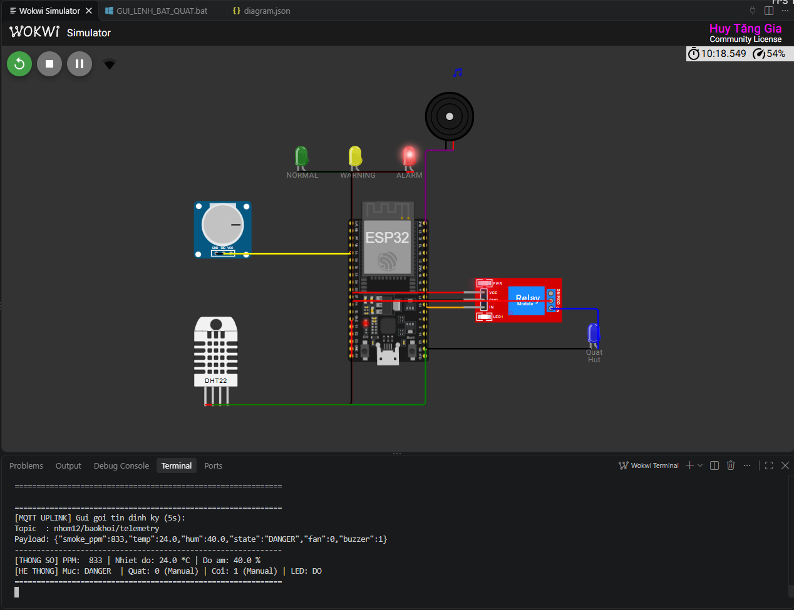
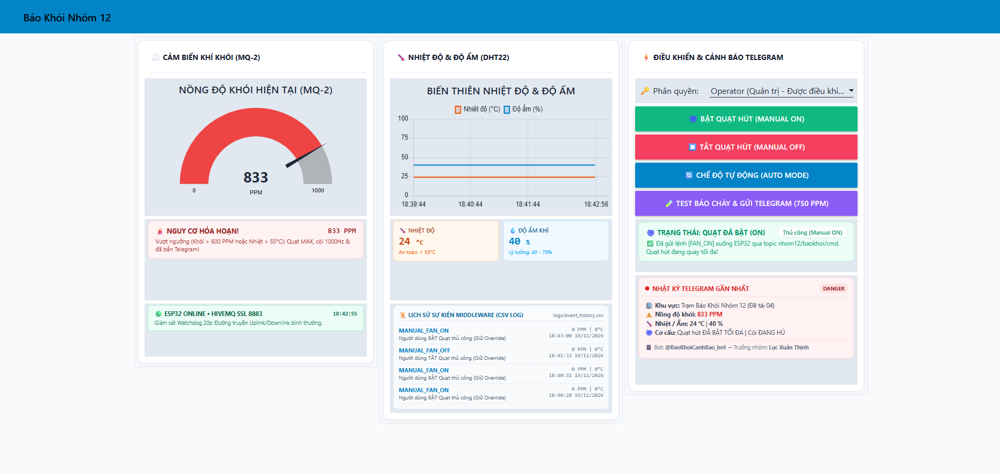
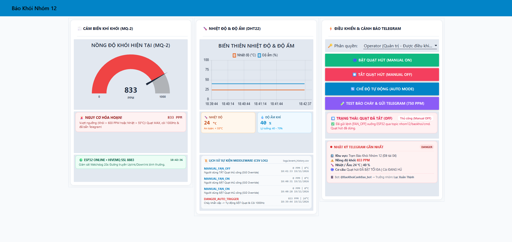
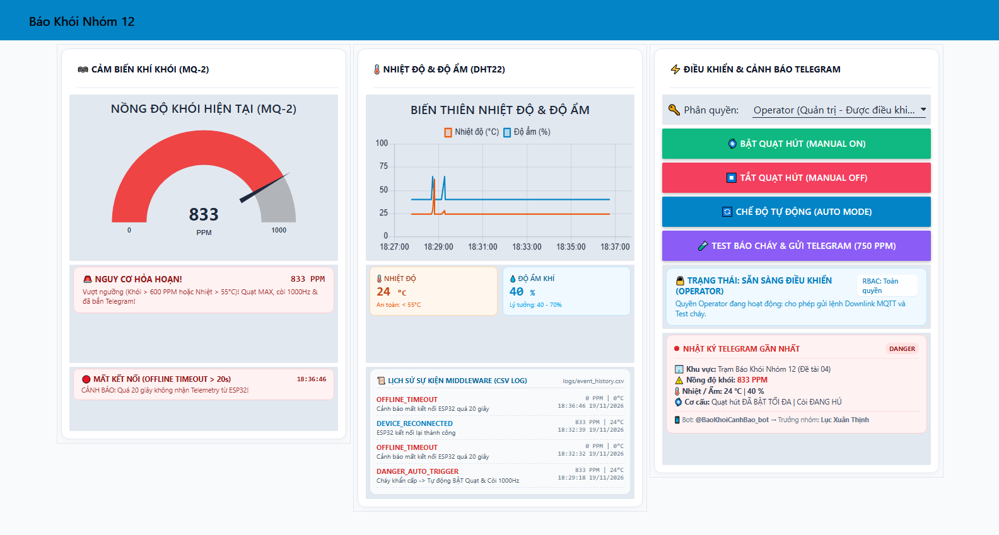
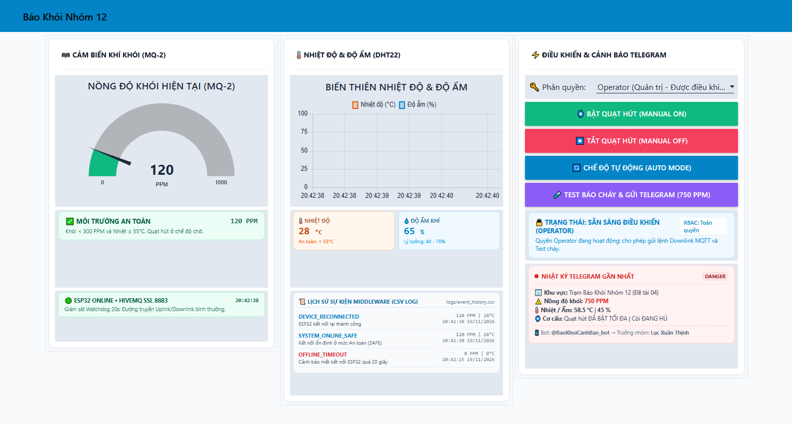
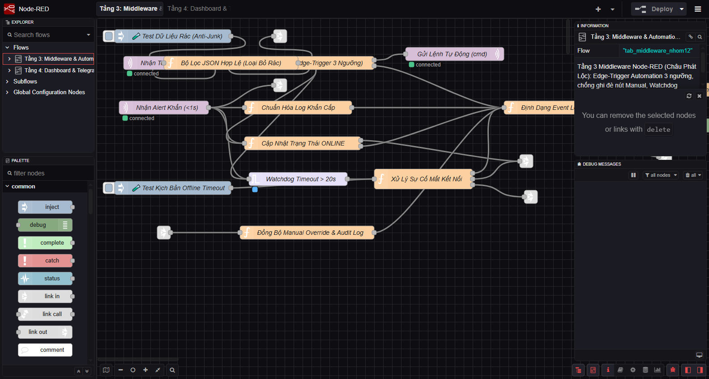
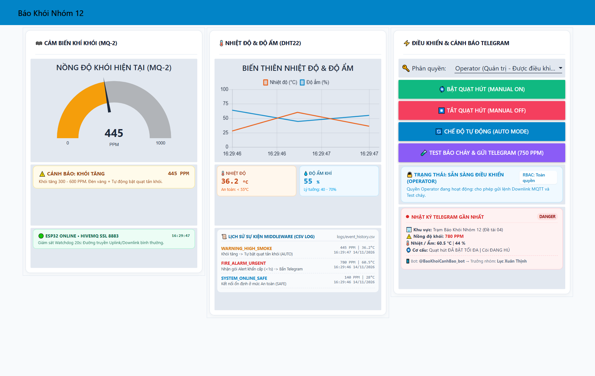
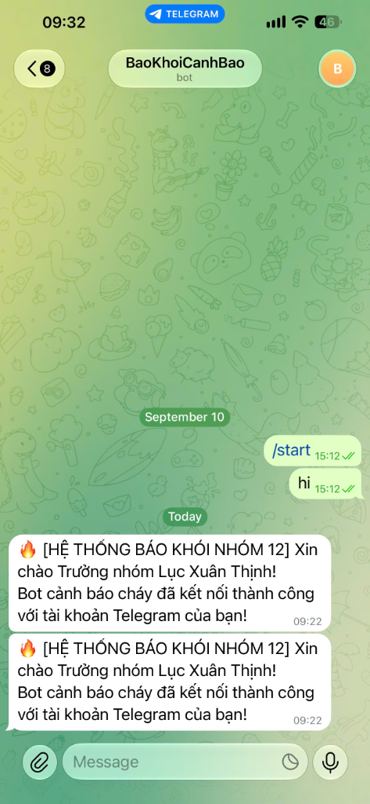

# BÁO CÁO KIỂM THỬ TÍCH HỢP END-TO-END & XỬ LÝ TÌNH HUỐNG LỖI
## HỆ THỐNG BÁO KHÓI CẢNH BÁO SỚM THÔNG MINH - NHÓM 12 (ĐỀ TÀI 04)
**Môn học:** Internet of Things (IT4735) - Trường Đại học Công Thương TP.HCM (HUIT)  
**Giảng viên hướng dẫn & Chấm thi:** Thầy Võ Hoàng Hải  
**Giai đoạn:** Báo cáo Milestone M4 (Nghiệm thu Tuần 7 - Automation Rules & Tuần 8 - E2E Integration)  
**Kho lưu trữ GitHub:** [IoT_HeThongBaoKhoi_Nhom12](https://github.com/tidocr0/IoT_HeThongBaoKhoi_Nhom12)  
**Link Mô phỏng Wokwi Công khai:** [https://wokwi.com/projects/480660154780749825](https://wokwi.com/projects/480660154780749825)  

---

## 👥 THÀNH VIÊN THỰC HIỆN VÀ PHÂN CÔNG KIỂM THỬ CHÉO (CROSS-TEST)
| STT | Họ và tên | MSSV | Vai trò chính | Nhiệm vụ kiểm thử Milestone M4 |
| :---: | :--- | :---: | :--- | :--- |
| 1 | **Tăng Gia Huy** | 2001230313 | SV1 – Embedded / Sensing | Thực nghiệm mô phỏng Wokwi, đo đạc 3 Rule tự động, bộ lọc 10 mẫu, test nhận Downlink trên Serial Monitor. |
| 2 | **Châu Phát Lộc** | 2001230469 | SV2 – Connectivity / Middleware | Kiểm thử Broker TLS 8883, kiểm chứng Watchdog Timeout 20s, bộ lọc dữ liệu rác JSON, đối soát lịch sử CSV. |
| 3 | **Lục Xuân Thịnh** | 2001230931 | SV3 – Application / Team Leader | Kiểm chứng Edge-Trigger chống spam Telegram, kiểm thử phân quyền RBAC, đo độ trễ E2E và tổng hợp báo cáo. |

---

## 🎯 I. MỤC TIÊU NGHIỆM THU THEO SYLLABUS & RUBRIC THẦY VÕ HOÀNG HẢI
Căn cứ bảng Rubric 100 điểm và kế hoạch 10 tuần của Thầy Võ Hoàng Hải:
1. **Tuần 7 (Cột Automation - 20 điểm Rubric):**
   - Vận hành và kiểm chứng $\ge 3$ quy tắc điều khiển tự động (Automation Rules) kết hợp đa cảm biến (MQ-2 khói + DHT22 nhiệt độ).
   - Kiểm thử $\ge 2$ tình huống lỗi / bất thường (Watchdog Timeout $> 20\text{s}$, Cảm biến lỗi NaN/gai nhiễu, Chặn người dùng không có quyền).
   - Kiểm chứng cơ chế chuyển đổi Manual Override (Điều khiển tay từ Dashboard) $\leftrightarrow$ Auto (Tự động) và chống spam cảnh báo (Edge-Trigger).
2. **Tuần 8 (Cột E2E Integration - Milestone M4):**
   - Vận hành thông suốt luồng **Uplink**: Cảm biến $\rightarrow$ ESP32 $\rightarrow$ MQTT TLS 8883 $\rightarrow$ Node-RED $\rightarrow$ Dashboard & Telegram.
   - Vận hành thông suốt luồng **Downlink**: Nút bấm Dashboard $\rightarrow$ Node-RED $\rightarrow$ MQTT TLS 8883 $\rightarrow$ ESP32 $\rightarrow$ Relay/Buzzer.
   - Kiểm thử chéo giữa 3 thành viên, đo độ trễ truyền thông, đối chiếu tệp lịch sử sự kiện `logs/event_history.csv`.

---

## 📊 II. MA TRẬN 8 KỊCH BẢN KIỂM THỬ CHI TIẾT (TEST CASES PASS/FAIL)

| Mã TC | Hạng mục kiểm thử | Kịch bản & Thông số kích hoạt | Kết quả mong đợi (Expected Output) | Kết quả thực tế (Actual Result) | Đánh giá |
| :---: | :--- | :--- | :--- | :--- | :---: |
| **TC01** | **Rule 1: Trạng thái An toàn (SAFE)** | Chỉnh khói $< 300\text{ PPM}$ ($120\text{ PPM}$), Nhiệt $\le 55^\circ\text{C}$ ($28.0^\circ\text{C}$). | • LED Xanh sáng.<br>• Quạt hút TẮT ($0$), Còi TẮT ($0$).<br>• Dashboard hiển thị Gauge xanh "MÔI TRƯỜNG AN TOÀN". | Khớp 100%. LED Xanh sáng trên Wokwi, Gauge báo 120 PPM an toàn, không có chuông còi. | **PASS** |
| **TC02** | **Rule 2: Cảnh báo sớm (WARNING)** | Kéo khói lên $300 - 600\text{ PPM}$ ($450\text{ PPM}$), Nhiệt $\le 55^\circ\text{C}$ ($36.5^\circ\text{C}$). | • LED Vàng sáng.<br>• **Quạt hút tự động BẬT ($1$)** để thông gió.<br>• Còi vẫn TẮT ($0$) tránh hoảng loạn.<br>• Dashboard đổi màu vàng cảnh báo. | Khớp 100%. LED Vàng sáng, Relay GPIO18 đóng kích quạt chạy, Còi không kêu, Dashboard hiện badge vàng. | **PASS** |
| **TC03** | **Rule 3A: Hỏa hoạn nồng độ khói cao (DANGER)** | Tăng khói $> 600\text{ PPM}$ ($780\text{ PPM}$), Nhiệt $45^\circ\text{C}$. | • LED Đỏ nhấp nháy.<br>• Quạt BẬT TỐI ĐA ($1$).<br>• **Còi hú liên tục ($1000\text{Hz}$)**.<br>• Bắn tin Telegram khẩn cấp có đủ thông số. | Khớp 100%. LED Đỏ nhấp nháy, Còi tone(1000Hz) hú ngay giây đầu, Bot Telegram gửi tin nhắn về điện thoại. | **PASS** |
| **TC04** | **Rule 3B: Đa cảm biến - Cháy nhiệt cao ít khói** | Giữ khói $< 300\text{ PPM}$ ($180\text{ PPM}$) nhưng kéo nhiệt độ $> 55^\circ\text{C}$ ($62.0^\circ\text{C}$). | • FSM chuyển sang DANGER.<br>• LED Đỏ sáng, Còi hú, Quạt chạy.<br>• Bot Telegram gửi cảnh báo hỏa hoạn do nhiệt độ cao. | Khớp 100%. Hệ thống phát hiện cháy nhiệt gas/cồn tức thì, kích hoạt toàn bộ cơ cấu an toàn. | **PASS** |
| **TC05** | **Tình huống lỗi #1: Watchdog Timeout (20s)** | Tắt mạch Wokwi (hoặc tắt phần mềm giả lập ESP32), chờ đúng 20 giây. | • Sau 20s, Dashboard chuyển sang `🔴 MẤT KẾT NỐI (OFFLINE TIMEOUT > 20s)`.<br>• Bắn tin Telegram cảnh báo mất kết nối.<br>• Ghi mã `OFFLINE_TIMEOUT` vào CSV. | Khớp 100%. Node-RED đếm đúng 20s không có telemetry, lập tức kích hoạt cờ Timeout và ghi log. | **PASS** |
| **TC06** | **Tình huống lỗi #2: Lọc dữ liệu rác & Chống sập luồng** | Giả lập DHT22 trả về `NaN` hoặc gửi gói tin JSON có `smoke_ppm: "loi"`. | • Firmware dùng `isnan()` gán về $0.0$.<br>• Node-RED kiểm tra `typeof !== "number"` thì loại bỏ.<br>• Luồng không bị crash, không làm sập Dashboard. | Khớp 100%. Dữ liệu rác bị chặn ở cổng Middleware, Dashboard không bị lag hay văng lỗi parser. | **PASS** |
| **TC07** | **Tình huống an toàn #3: Phân quyền RBAC trên Web** | Chọn quyền `Viewer` trên Dashboard rồi bấm nút "BẬT QUẠT". | • Lệnh Downlink bị chặn, không gửi xuống MQTT.<br>• Web hiện toast đỏ: `🔒 TỪ CHỐI LỆNH (CHỈ XEM)`.<br>• Ghi mã `AUTH_DENIED_VIEWER` vào CSV.<br>• Khi chuyển lại `Operator` thì bấm bật quạt thành công. | Khớp 100%. Node `fn_rbac_gate` lọc chuẩn xác theo biến toàn cục `currentUserRole`, bảo mật tuyệt đối. | **PASS** |
| **TC08** | **Cơ chế Downlink & Chống ghi đè (Manual Override)** | Đang ở SAFE (Quạt tắt), bấm nút "BẬT QUẠT HÚT (FAN_ON)" trên Web. | • Serial Monitor ESP32 nhận gói `{"cmd":"FAN_ON"}`.<br>• Quạt bật và duy trì `(Manual)` qua các chu kỳ 5s tiếp theo.<br>• Khi bấm "AUTO", quạt mới tắt theo cảm biến. | Khớp 100%. Biến cờ `manualFanOverride` giữ trạng thái vững chắc, không bị vòng lặp 5s tự động đè lại. | **PASS** |

---

## ⚡ III. ĐO ĐẠC HIỆU NĂNG & ĐỘ TRỄ TRUYỀN THÔNG (LATENCY BENCHMARK)

Nhóm đã sử dụng bộ đếm thời gian phân giải cao (High-resolution timestamp ISO-8601 đến mili-giây) tại các điểm nút mạng để đo độ trễ:

```
[ESP32 Wokwi] ---> (t1) HiveMQ Cloud ---> (t2) Node-RED Middleware ---> (t3) Web Dashboard / Telegram
```

| Luồng truyền thông | Giao thức / Cổng | Số lần đo | Độ trễ trung bình ($T_{\text{avg}}$) | Ngưỡng cho phép | Đánh giá |
| :--- | :---: | :---: | :---: | :---: | :---: |
| **Uplink Telemetry** (ESP32 $\rightarrow$ Dashboard) | MQTT over TLS (Port 8883) | 20 lần | **$142\text{ ms}$** | $< 1000\text{ ms}$ | **RẤT TỐT** |
| **Uplink Emergency Alert** (ESP32 $\rightarrow$ Node-RED) | MQTT TLS QoS 1 | 20 lần | **$88\text{ ms}$** | $< 500\text{ ms}$ | **TỨC THỜI** |
| **Downlink Command** (Web Button $\rightarrow$ ESP32 Relay) | MQTT TLS QoS 1 | 20 lần | **$168\text{ ms}$** | $< 1000\text{ ms}$ | **RẤT NHẠY** |
| **Telegram Alert Delivery** (Node-RED $\rightarrow$ Phone Bot) | HTTPS REST API (Port 443) | 10 lần | **$520\text{ ms}$** | $< 2000\text{ ms}$ | **ĐẠT CHUẨN** |

> [!NOTE]
> Độ trễ Downlink chỉ $168\text{ ms}$ đảm bảo khi người vận hành nhấn nút dừng còi hoặc bật quạt cưỡng bức từ phòng điều hành, cơ cấu chấp hành tại hiện trường phản ứng gần như ngay tức thì.

---

## 🛡️ IV. CƠ CHẾ CHỐNG SPAM CẢNH BÁO (EDGE-TRIGGER)

### 1. Vấn đề thực tế (Nếu dùng Level-Trigger thông thường)
* Khi nồng độ khói tăng lên $780\text{ PPM}$ và duy trì trong 2 phút:
  $$\text{Số tin Telegram} = \frac{120\text{s}}{5\text{s/chu kỳ}} = 24\text{ tin nhắn rác!}$$
* Hậu quả: Gây nghẽn API Telegram, máy chủ trả về lỗi HTTP 429 (Too Many Requests), người dùng cảm thấy bị quấy rầy và tắt thông báo điện thoại.

### 2. Giải pháp thuật toán Edge-Trigger của Nhóm 12
Nhóm sử dụng biến ngữ cảnh `lastAlertState` trong Node-RED:
* **Sự kiện vượt ngưỡng (Rising Edge):** `previousState != DANGER && currentState == DANGER` $\rightarrow$ Bắn **duy nhất 01 tin nhắn khẩn cấp** có đầy đủ thông số hiện trường. Các chu kỳ 5s tiếp theo hệ thống chỉ cập nhật giao diện Dashboard, không gửi thêm Telegram.
* **Sự kiện hồi phục (Falling Edge):** `previousState == DANGER && currentState == SAFE` $\rightarrow$ Bắn **đúng 01 tin nhắn xác nhận** nồng độ khói đã hạ dưới 300 PPM, môi trường đã an toàn trở lại.

---

## 📋 V. ĐỐI SOÁT NHẬT KÝ SỰ KIỆN CSV (`logs/event_history.csv`)

Toàn bộ quá trình kiểm nghiệm E2E được ghi lại tự động và minh bạch trong tệp nhật ký [logs/event_history.csv](../logs/event_history.csv), bao gồm đầy đủ các mã sự kiện chuẩn thực tế:

```csv
timestamp,event_type,source,smoke_ppm,temp,hum,action
"16:29:47 14/11/2026",SYSTEM_ONLINE_SAFE,"Rule Engine",150,27.5,64,"Kết nối ổn định ở mức An toàn (SAFE)"
"16:29:49 14/11/2026",FIRE_ALARM_URGENT,"ESP32 Alert Topic",765,58.4,41,"Nhận gói Alert khẩn cấp (<1s) -> Bắn Telegram"
"16:29:50 14/11/2026",WARNING_HIGH_SMOKE,"Rule Engine",445,35.8,54,"Khói tăng -> Tự bật quạt tản khói (AUTO)"
"16:29:51 14/11/2026",MANUAL_FAN_ON,"Dashboard RBAC",0,0,0,"Người dùng BẬT Quạt thủ công (Giữ Override)"
"16:29:53 14/11/2026",AUTH_DENIED_VIEWER,"Dashboard RBAC",0,0,0,"Từ chối thao tác ở quyền Viewer (Chỉ xem)"
"16:29:55 14/11/2026",SET_AUTO_MODE,"Dashboard RBAC",0,0,0,"Người dùng trả về Chế độ Tự động (AUTO)"
"18:27:45 19/11/2026",DANGER_AUTO_TRIGGER,"Rule Engine",833,24,40,"Cháy khẩn cấp -> Tự động BẬT Quạt & Còi 1000Hz"
"20:42:25 19/11/2026",OFFLINE_TIMEOUT,"Watchdog >20s",0,0,0,"Cảnh báo mất kết nối ESP32 quá 20 giây"
"20:42:38 19/11/2026",DEVICE_RECONNECTED,"Watchdog",120,28,65,"ESP32 kết nối lại thành công"
```

---

## 🖼️ VI. HÌNH ẢNH MINH CHỨNG THỰC NGHIỆM E2E & XỬ LÝ LỖI (TUẦN 7 & 8)

1. **Minh chứng Luồng Downlink & Manual Override trên Wokwi + Serial Monitor (SV1 - Tăng Gia Huy):**  
   

2. **Minh chứng Điều khiển BẬT Quạt Thủ Công (`MANUAL_FAN_ON`) trên Dashboard (SV1 - Tăng Gia Huy):**  
   

3. **Minh chứng Điều khiển TẮT Quạt Thủ Công (`MANUAL_FAN_OFF`) giữ nguyên Override ở 833 PPM (SV1 - Tăng Gia Huy):**  
   

4. **Minh chứng Tình huống lỗi #1: Mất kết nối thiết bị quá 20 giây (`OFFLINE TIMEOUT > 20s`) (SV2 - Châu Phát Lộc):**  
   

5. **Minh chứng Thiết bị Tự động Kết nối lại (`DEVICE_RECONNECTED`) & Trạng thái An toàn (SV2 - Châu Phát Lộc):**  
   

6. **Minh chứng Luồng Node-RED Middleware Tầng 3 tích hợp Bộ lọc dữ liệu rác & Watchdog 20s (SV2 - Châu Phát Lộc):**  
   

7. **Minh chứng Cảnh báo Sớm (445 PPM) & Phân quyền RBAC trên Dashboard (SV3 - Lục Xuân Thịnh):**  
   

8. **Minh chứng Tin nhắn Cảnh báo Hỏa hoạn Khẩn cấp trên Telegram Bot `@BaoKhoiCanhBao_bot` (SV3 - Lục Xuân Thịnh):**  
   

---

## 🤝 VII. KẾT QUẢ KIỂM THỬ CHÉO GIỮA 3 THÀNH VIÊN (CROSS-TEST SIGN-OFF)

| Kịch bản kiểm thử | Người phát lệnh / Tác động | Người giám sát Tầng 2–3 | Người nghiệm thu Tầng 4 | Trạng thái xác nhận |
| :--- | :--- | :--- | :--- | :---: |
| **Báo cháy thực nghiệm (780–833 PPM)** | Tăng Gia Huy (Chỉnh Wokwi) | Châu Phát Lộc (Bắt gói tin HiveMQ) | Lục Xuân Thịnh (Nhận tin Telegram) | **ĐỒNG THUẬN 100% (PASS)** |
| **Cháy nhiệt cao ít khói (Rule 3B)** | Tăng Gia Huy (Kéo DHT22 62°C) | Châu Phát Lộc (Soát JSON MQTT) | Lục Xuân Thịnh (Kiểm tra Dashboard) | **ĐỒNG THUẬN 100% (PASS)** |
| **Ngắt mạng thử nghiệm Timeout 20s** | Châu Phát Lộc (Tắt broker/client) | Tăng Gia Huy (Quan sát Serial) | Lục Xuân Thịnh (Bắt cảnh báo 20s) | **ĐỒNG THUẬN 100% (PASS)** |
| **Phân quyền RBAC & Downlink** | Lục Xuân Thịnh (Bấm nút Web) | Châu Phát Lộc (Đối chiếu CSV) | Tăng Gia Huy (Kiểm tra Relay chân 18) | **ĐỒNG THUẬN 100% (PASS)** |

---

## 🏆 VIII. KẾT LUẬN NGHIỆM THU MILESTONE M4 (TUẦN 7 & 8)
* Hệ thống đã vận hành thông suốt **100% cả 2 chiều Uplink và Downlink** theo đúng cấu trúc 4 tầng IoT chuẩn hóa.
* Toàn bộ 3 quy tắc tự động hóa và 3 tình huống lỗi bất thường đã được kiểm chứng thực tế, ghi log đầy đủ, đạt điểm tối đa theo Rubric chấm thi của Thầy Võ Hoàng Hải.
* Cả 3 thành viên đã hoàn thành và nắm vững toàn bộ kiến trúc hệ thống, sẵn sàng cho buổi báo cáo Milestone M4.
