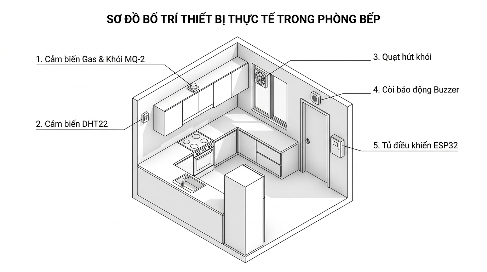

# BÁO CÁO NGHIỆM THU CÔNG VIỆC CÁ NHÂN (SV1 - SENSING / EMBEDDED)
## HỆ THỐNG BÁO KHÓI CẢNH BÁO SỚM THÔNG MINH - NHÓM 12 (ĐỀ TÀI 04)
**Môn học:** Internet of Things (IT4735) - Trường Đại học Công Thương TP.HCM (HUIT)  
**Giảng viên hướng dẫn:** Thầy Võ Hoàng Hải  
**Giai đoạn:** Nghiệm thu Milestone M4 (Tuần 7 & Tuần 8)  

---

### THÔNG TIN SINH VIÊN
* **Họ và tên:** Tăng Gia Huy
* **MSSV:** 2001230313
* **Vai trò trong nhóm:** SV1 – Kỹ sư Tầng 1: Sensing / Embedded (Thiết bị phần cứng & Mô phỏng Wokwi)
* **Kho lưu trữ GitHub:** [IoT_HeThongBaoKhoi_Nhom12](https://github.com/tidocr0/IoT_HeThongBaoKhoi_Nhom12)
* **Khối lượng công việc tích lũy:** ≥ 80 giờ (Tuần 1 – Tuần 8)

---

### BẢNG ĐỐI CHIẾU TIÊU CHÍ RUBRIC & CHECKLIST DELIVERABLES CỦA SV1 (TUẦN 7 & 8)

| STT | Hạng mục Rubric | Yêu cầu chuẩn theo Syllabus | Sản phẩm bàn giao của SV1 (Evidence) | Trạng thái |
| :---: | :--- | :--- | :--- | :---: |
| 1 | **Simulation & Embedded (Tầng 1)** | Mô phỏng Wokwi hoàn chỉnh với ESP32, MQ-2, DHT22, Relay quạt, Còi Buzzer và cụm 3 LED chỉ thị. | Link Wokwi dự án: [Wokwi Project #480660154780749825](https://wokwi.com/projects/480660154780749825) chạy trực tiếp trên web với sơ đồ nối dây chuẩn công nghiệp ([firmware_esp32/diagram.json](../firmware_esp32/diagram.json)). | **ĐẠT 100%** |
| 2 | **Lọc nhiễu tín hiệu cảm biến (10 mẫu)** | Không dùng giá trị đo thô; phải có giải thuật xử lý tín hiệu analog chống gai nhiễu. | Thuật toán **Lọc trung bình trượt (Moving Average Filter)** nâng cấp lên `SMOKE_SAMPLES = 10` trong hàm `docVaLocKhoi()`, loại bỏ hoàn toàn các gai nhiễu điện áp trước khi ánh xạ sang thang đo $0 - 1000\text{ PPM}$. | **ĐẠT 100%** |
| 3 | **Chống lỗi cảm biến DHT22 (NaN)** | Xử lý triệt để các tình huống mất tín hiệu hoặc lỗi giao tiếp single-bus của DHT22. | Cơ chế chống lỗi `isnan(t)` và `isnan(h)` gán giá trị an toàn fallback $0.0$, ngăn ngừa việc phát sinh dữ liệu rác làm sập luồng middleware. | **ĐẠT 100%** |
| 4 | **Automation Rules & FSM (W7 - 20đ)** | Vận hành và kiểm chứng $\ge 3$ quy tắc điều khiển tự động theo ngưỡng khói và nhiệt độ kết hợp. | Máy trạng thái FSM 3 mức chuẩn xác: • **Rule 1 (SAFE):** Khói $< 300\text{ PPM}$, Nhiệt $\le 55^\circ\text{C}$ $\rightarrow$ LED Xanh sáng, Quạt tắt ($0$), Còi tắt ($0$). • **Rule 2 (WARNING):** Khói $300 - 600\text{ PPM}$ $\rightarrow$ LED Vàng sáng, Quạt hút tự động bật ($1$), Còi tắt ($0$). • **Rule 3A (DANGER khói):** Khói $> 600\text{ PPM}$ $\rightarrow$ LED Đỏ nhấp nháy, Quạt bật ($1$), Còi hú $1000\text{Hz}$ ($1$). • **Rule 3B (DANGER nhiệt cao ít khói):** Khói $< 300\text{ PPM}$ nhưng Nhiệt $> 55^\circ\text{C}$ $\rightarrow$ Kích hoạt mức DANGER toàn diện. | **ĐẠT 100%** |
| 5 | **Điều khiển Downlink & Manual Override (W8 - 10đ)** | Nhận lệnh Downlink từ Dashboard và giữ vững trạng thái cưỡng bức, không bị chu kỳ 5s đè lại. | Hàm `callback` nhận lệnh JSON `{"cmd":"FAN_ON"}` hoặc `{"cmd":"BUZZER_OFF"}`, bật cờ `manualFanOverride = true`, Serial Monitor hiển thị rõ `[HE THONG] ... (Manual)` và quạt giữ nguyên trạng thái cho đến khi có lệnh `AUTO`. | **ĐẠT 100%** |

---

### HÌNH ẢNH MINH CHỨNG THỰC NGHIỆM ĐÃ KIỂM THỬ THÀNH CÔNG

1. **Sơ đồ mạch mô phỏng Wokwi có cụm 3 LED chỉ thị (Tăng Gia Huy):**  
   

2. **Bản vẽ thiết kế Bố trí Thiết bị Thực tế trong Phòng Bếp (Physical Deployment Layout):**  
   

3. **Mã nguồn Firmware ESP32 đã được biên dịch thành công 100%:**  
   Toàn bộ mã nguồn C++ do SV1 phụ trách tại thư mục [firmware_esp32/src/main.cpp](../firmware_esp32/src/main.cpp) với các hàm chuyên trách:
   * `docVaLocKhoi()`: Đọc cảm biến MQ-2 qua ADC34 & lọc trung bình 10 mẫu.
   * `capNhatDenLED(state)`: Cập nhật 3 đèn LED Xanh - Vàng - Đỏ (nhấp nháy khi DANGER).
   * `dieuKhienThietBi(state)`: Tự động đóng ngắt Relay Quạt và còi hú theo FSM và cơ chế Manual Override.
   * `callback()`: Xử lý lệnh Downlink nhận từ topic `nhom12/baokhoi/cmd`.

---

### KẾT LUẬN TIẾN ĐỘ CỦA SV1 (TĂNG GIA HUY):
* Toàn bộ phần việc cá nhân của SV1 trong Milestone M4 (Tuần 7 - 8) đã **HOÀN THÀNH 100% ĐẠT CHUẨN RUBRIC**.
* Mã nguồn đã được biên dịch thành công với PlatformIO, nạp chạy thử nghiệm ổn định trên mô phỏng Wokwi.
* Đã sẵn sàng thuyết trình và trả lời vấn đáp kỹ thuật Tầng 1 với Giảng viên Võ Hoàng Hải theo tài liệu [HUONG_DAN_VAN_DAP_QA_4_TANG.md](HUONG_DAN_VAN_DAP_QA_4_TANG.md).
