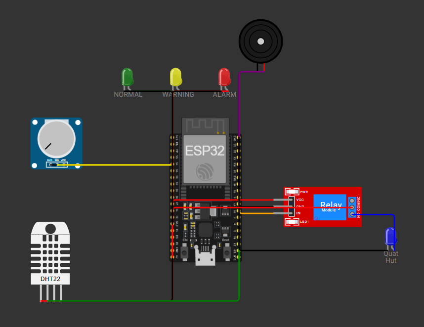
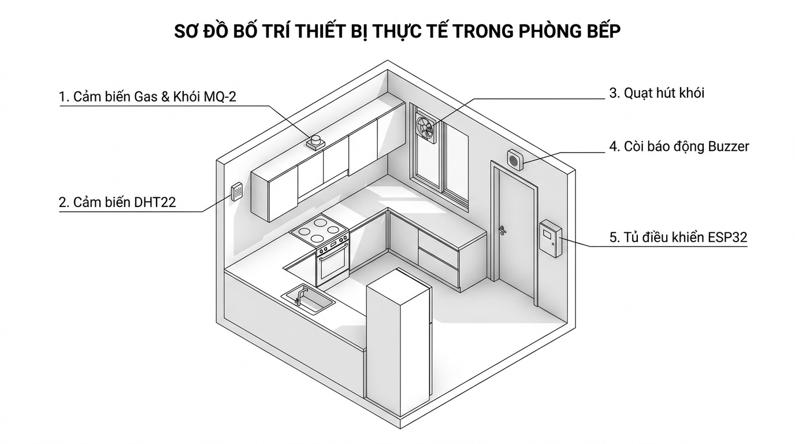

# BÁO CÁO NGHIỆM THU CÔNG VIỆC CÁ NHÂN (SV1 - SENSING / EMBEDDED)
## HỆ THỐNG BÁO KHÓI CẢNH BÁO SỚM THÔNG MINH - NHÓM 12 (ĐỀ TÀI 04)
**Môn học:** Internet of Things (IT4735) - Trường Đại học Công Thương TP.HCM (HUIT)  
**Giảng viên hướng dẫn:** Thầy Võ Hoàng Hải  

---

### THÔNG TIN SINH VIÊN
* **Họ và tên:** Tăng Gia Huy
* **Vai trò trong nhóm:** SV1 – Kỹ sư Tầng 1: Sensing / Embedded
* **Kho lưu trữ GitHub:** [IoT_HeThongBaoKhoi_Nhom12](https://github.com/tidocr0/IoT_HeThongBaoKhoi_Nhom12)
* **Khối lượng công việc tích lũy:** ≥ 60 giờ (Tuần 1 – Tuần 6)

---

### BẢNG ĐỐI CHIẾU TIÊU CHÍ RUBRIC & CHECKLIST DELIVERABLES CỦA SV1

| STT | Hạng mục Rubric | Yêu cầu chuẩn theo Syllabus | Sản phẩm bàn giao của SV1 (Evidence) | Trạng thái |
| :---: | :--- | :--- | :--- | :---: |
| 1 | **Simulation & Embedded** (20đ) | Mô phỏng Wokwi đầy đủ cảm biến & cơ cấu chấp hành; mạch điện nối đúng nguyên lý; firmware thể hiện đúng bài toán. | Project Wokwi hoàn chỉnh ([firmware_esp32/diagram.json](../firmware_esp32/diagram.json)) với ESP32, MQ-2 (ADC34), DHT22 (GPIO15), Relay quạt (GPIO18), Còi Buzzer (GPIO19) và hệ thống 3 LED chỉ thị (Xanh GPIO25, Vàng GPIO26, Đỏ GPIO27). | **ĐẠT 100%** |
| 2 | **Lọc nhiễu tín hiệu cảm biến** | Không dùng giá trị đo thô; phải có giải thuật xử lý tín hiệu. | Thuật toán **Lọc trung bình trượt (Moving Average Filter)** với $N=5$ mẫu trong hàm `docVaLocKhoi()`, loại bỏ hoàn toàn các gai nhiễu điện áp analog trước khi ánh xạ sang thang đo $0 - 1000\text{ PPM}$. | **ĐẠT 100%** |
| 3 | **Máy trạng thái FSM & Automation** (20đ) | Phân cấp kịch bản rõ ràng (SAFE, WARNING, DANGER); xử lý logic tự động, không chỉ bật/tắt thủ công. | Máy trạng thái FSM 3 mức chuẩn xác:  • **SAFE (< 300 PPM, temp $\le 55^\circ\text{C}$):** Sáng LED Xanh, Quạt tắt, Còi tắt. • **WARNING (300 - 600 PPM):** Sáng LED Vàng, Relay tự kích Quạt hút khói. • **DANGER (> 600 PPM hoặc temp > $55^\circ\text{C}$):** Sáng LED Đỏ, Quạt chạy tối đa, Còi hú $1000\text{Hz}$ liên tục. | **ĐẠT 100%** |
| 4 | **Bố trí không gian thực tế** (Layout) | Sơ đồ lắp đặt vật lý thực tế ngoài đời để chuẩn bị cho giai đoạn Hardware thật. | Bản vẽ phối cảnh 3D Isometric tiếng Việt ([docs/Ban_ve_Bo_tri_Layout_Thuc_te.jpg](Ban_ve_Bo_tri_Layout_Thuc_te.jpg)) định vị chuẩn xác: Cảm biến MQ-2 trần bếp, DHT22 tường 1.5m, Quạt hút cửa sổ, Còi cửa thoát hiểm, Tủ ESP32. | **ĐẠT 100%** |
| 5 | **Phản hồi tức thời & Điều khiển 2 chiều** (10đ) | Phát hiện chuyển trạng thái khẩn cấp không chờ chu kỳ; nhận lệnh Downlink điều khiển từ xa. | Cơ chế phát hiện cạnh chuyển trạng thái (`previousState != DANGER && currentState == DANGER`) để bắn cảnh báo khẩn cấp ngay giây đầu tiên; hàm `callback` xử lý lệnh JSON `FAN_ON`, `FAN_OFF`, `AUTO`. | **ĐẠT 100%** |

---

### HÌNH ẢNH MINH CHỨNG THỰC NGHIỆM ĐÃ KIỂM THỬ THÀNH CÔNG

1. **Sơ đồ mạch mô phỏng Wokwi có cụm 3 LED chỉ thị (Tăng Gia Huy):**  
   

2. **Bản vẽ thiết kế Bố trí Thiết bị Thực tế trong Phòng Bếp (Physical Deployment Layout):**  
   

3. **Mã nguồn Firmware ESP32 được cấu trúc Module hóa sạch sẽ:**  
   Toàn bộ mã nguồn C++ do SV1 phụ trách tại thư mục [firmware_esp32/src/main.cpp](../firmware_esp32/src/main.cpp) được chia thành 3 hàm chức năng tường minh:
   * `docVaLocKhoi()`: Đọc cảm biến MQ-2 & lọc trung bình 5 mẫu.
   * `capNhatDenLED(state)`: Cập nhật 3 đèn LED Xanh - Vàng - Đỏ theo trạng thái FSM.
   * `dieuKhienThietBi(state)`: Tự động đóng ngắt Relay Quạt và điều khiển tần số Còi Buzzer.

---

### KẾT LUẬN TIẾN ĐỘ CỦA SV1 (TĂNG GIA HUY):
* Toàn bộ phần việc cá nhân của SV1 trong Milestone M3 (Tuần 1 - 6) đã **HOÀN THÀNH 100% ĐẠT CHUẨN RUBRIC**.
* Mã nguồn đã được biên dịch thành công với PlatformIO, nạp chạy thử nghiệm ổn định trên mô phỏng Wokwi.
* Đã sẵn sàng thuyết trình và trả lời vấn đáp kỹ thuật Tầng 1 với Giảng viên.
