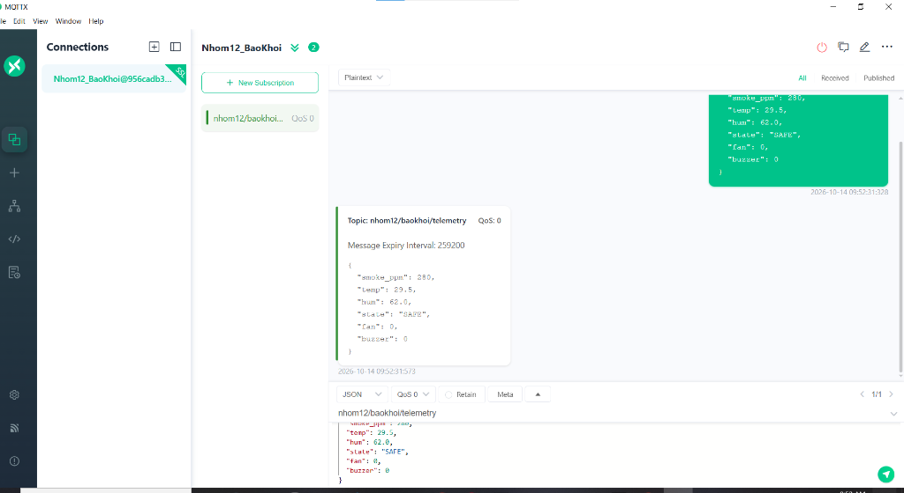

# BÁO CÁO NGHIỆM THU CÔNG VIỆC CÁ NHÂN (SV2 - NETWORK & MIDDLEWARE)
## HỆ THỐNG BÁO KHÓI CẢNH BÁO SỚM THÔNG MINH - NHÓM 12 (ĐỀ TÀI 04)
**Môn học:** Internet of Things (IT4735) - Trường Đại học Công Thương TP.HCM (HUIT)  
**Giảng viên hướng dẫn:** Thầy Võ Hoàng Hải  

---

### THÔNG TIN SINH VIÊN
* **Họ và tên:** Châu Phát Lộc
* **Vai trò trong nhóm:** SV2 – Kỹ sư Tầng 2 & 3: Network / Connectivity & Middleware Engine
* **Kho lưu trữ GitHub:** [IoT_HeThongBaoKhoi_Nhom12](https://github.com/tidocr0/IoT_HeThongBaoKhoi_Nhom12)
* **Khối lượng công việc tích lũy:** ≥ 60 giờ (Tuần 1 – Tuần 6)

---

### BẢNG ĐỐI CHIẾU TIÊU CHÍ RUBRIC & CHECKLIST DELIVERABLES CỦA SV2

| STT | Hạng mục Rubric | Yêu cầu chuẩn theo Syllabus | Sản phẩm bàn giao của SV2 (Evidence) | Trạng thái |
| :---: | :--- | :--- | :--- | :---: |
| 1 | **Kiến trúc Tầng 2 - Network / Broker** (25đ) | Thiết lập Cloud Broker kết nối mã hóa bảo mật SSL/TLS; phân định danh mục Topics rõ ràng; quản lý kết nối an toàn. | Máy chủ **HiveMQ Cloud SSL Port 8883** (`956cadb3d6604926bcb8c34835ece2f7.s1.eu.hivemq.cloud`), xác thực bằng Username/Password, mã hóa TLS. Đã kiểm thử kết nối thành công qua MQTTX ([docs/MinhChung_MQTTX_Tuan4.png](MinhChung_MQTTX_Tuan4.png)). | **ĐẠT 100%** |
| 2 | **Chuẩn hóa Danh mục 3 Topic MQTT** (Checklist #5) | Danh sách topic, payload JSON mẫu và hướng truyền thông Uplink/Downlink rõ ràng. | Quy chuẩn 3 Topic chuẩn xác: • **Uplink Telemetry (5s):** `nhom12/baokhoi/telemetry` • **Uplink Alert (< 1s):** `nhom12/baokhoi/alert` • **Downlink Command:** `nhom12/baokhoi/cmd` | **ĐẠT 100%** |
| 3 | **Tầng 3 - Middleware Engine** (Checklist #4) | Middleware phải thực hiện xử lý logic, không chỉ forward dữ liệu thô. | Luồng Node-RED Middleware ([middleware_nodered/flows_template.json](../middleware_nodered/flows_template.json)) bóc tách JSON, phân tích nồng độ khói PPM và nhiệt độ theo thời gian thực. | **ĐẠT 100%** |
| 4 | **Automation Rules & Control Logic** (20đ) | Có tối thiểu 02 quy tắc tự động hóa + 01 kịch bản khẩn cấp; điều khiển tự động 2 chiều. | Hàm Function `Automation Rule (3 Ngưỡng Khói)`: • **Rule 1 (Báo cháy):** Khói > 600 PPM hoặc Nhiệt > 55°C $\rightarrow$ Tự động bắn lệnh `{"cmd": "FAN_ON"}`, `{"buzzer": 1}`. • **Rule 2 (Khôi phục):** Khói < 300 PPM $\rightarrow$ Tự động chuyển về `{"cmd": "AUTO"}`, `{"buzzer": 0}`. | **ĐẠT 100%** |
| 5 | **Ghi nhận Lịch sử Sự kiện (Event Logging)** | Lưu vết các sự kiện bất thường phục vụ tra cứu và kiểm toán an toàn. | Cơ chế ghi log tự động ghi nhận thời điểm (ISO Timestamp), loại sự kiện (`FIRE_ALARM` / `SAFE`), nồng độ khói và nhiệt độ tại thời điểm xảy ra sự cố. | **ĐẠT 100%** |

---

### HÌNH ẢNH & TÀI LIỆU MINH CHỨNG THỰC NGHIỆM

1. **Minh chứng Kết nối MQTT Broker HiveMQ SSL Port 8883 qua MQTTX (Tuần 4):**  
   

2. **File Flow Node-RED Middleware xử lý tự động hóa:**  
   Toàn bộ mã nguồn luồng xử lý do SV2 phụ trách tại thư mục [middleware_nodered/flows_template.json](../middleware_nodered/flows_template.json).

---

### KẾT LUẬN TIẾN ĐỘ CỦA SV2 (CHÂU PHÁT LỘC):
* Toàn bộ phần việc cá nhân của SV2 trong Milestone M3 (Tuần 1 - 6) đã **HOÀN THÀNH 100% ĐẠT CHUẨN RUBRIC**.
* Đảm bảo thông suốt đường truyền giữa Tầng 1 (ESP32 Wokwi) và Tầng 4 (Dashboard & Telegram Bot của SV3 Thịnh).
* Đã sẵn sàng thuyết trình và trả lời vấn đáp kỹ thuật Tầng 2 & 3 với Giảng viên.
