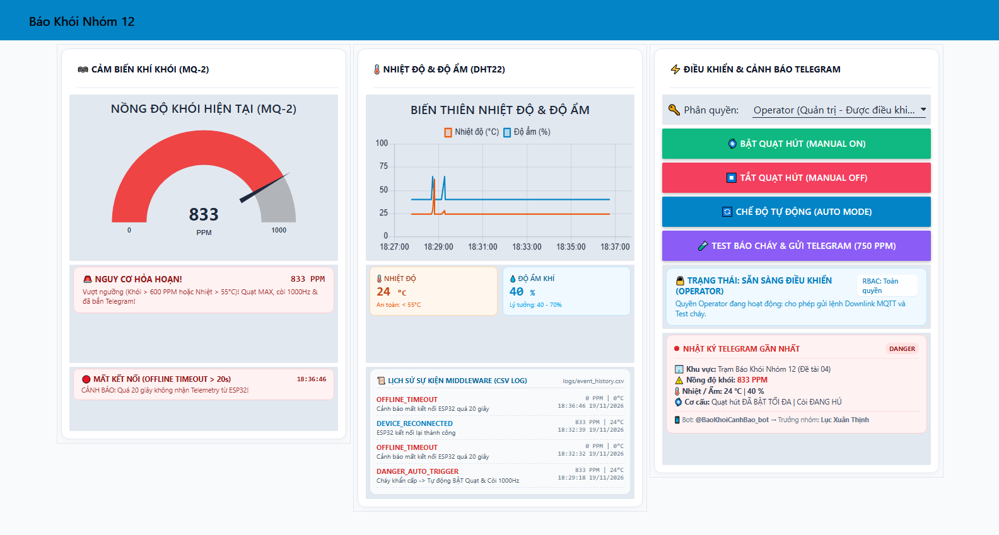
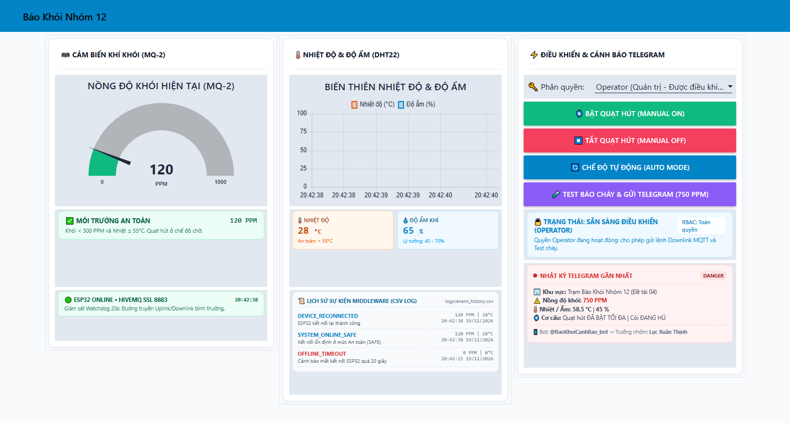
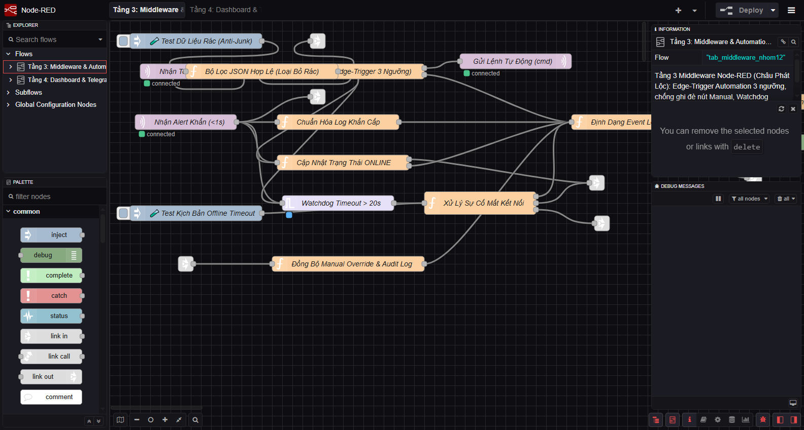
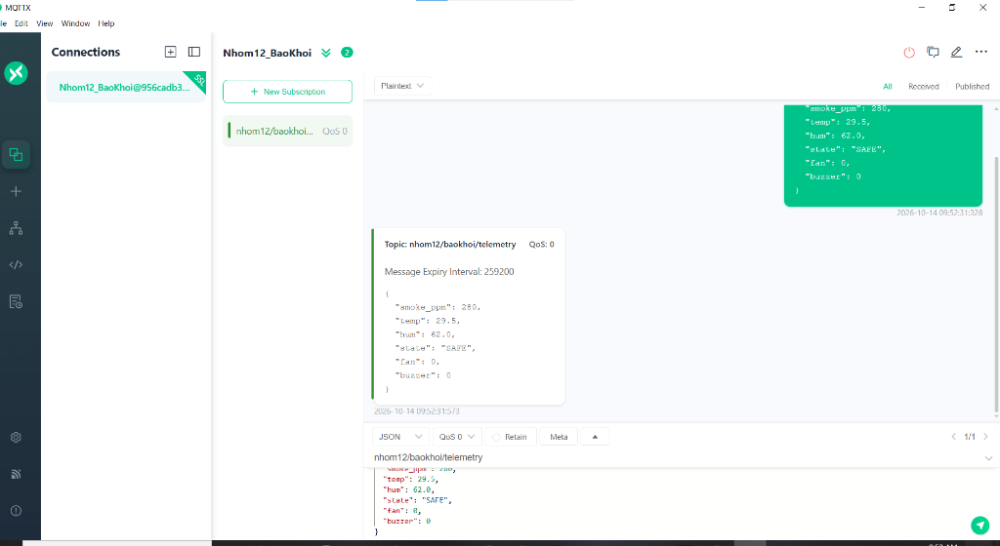
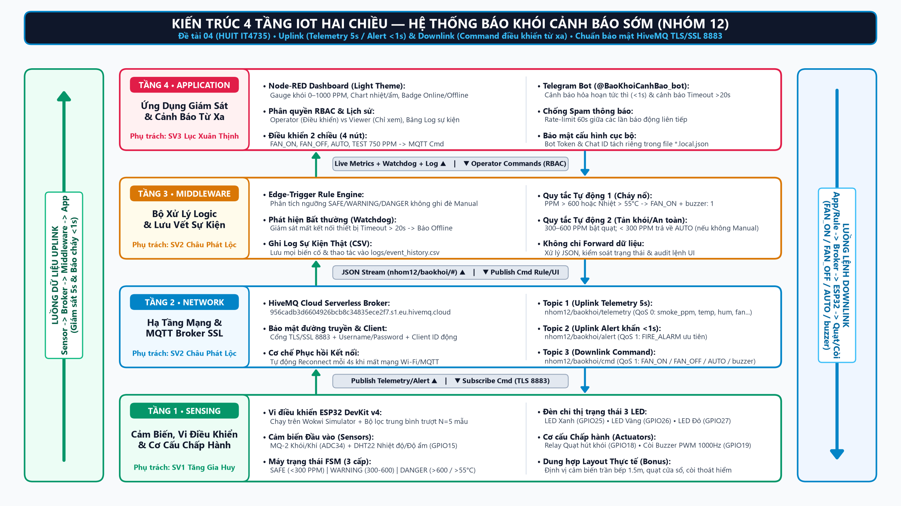

# BÁO CÁO NGHIỆM THU CÔNG VIỆC CÁ NHÂN (SV2 - NETWORK & MIDDLEWARE)
## HỆ THỐNG BÁO KHÓI CẢNH BÁO SỚM THÔNG MINH - NHÓM 12 (ĐỀ TÀI 04)
**Môn học:** Internet of Things (IT4735) - Trường Đại học Công Thương TP.HCM (HUIT)  
**Giảng viên hướng dẫn:** Thầy Võ Hoàng Hải  

---

### THÔNG TIN SINH VIÊN
* **Họ và tên:** Châu Phát Lộc
* **MSSV:** 2001230469
* **Vai trò trong nhóm:** SV2 – Kỹ sư Tầng 2 & 3: Network / Connectivity & Middleware Engine
* **Kho lưu trữ GitHub:** [IoT_HeThongBaoKhoi_Nhom12](https://github.com/tidocr0/IoT_HeThongBaoKhoi_Nhom12)
* **Khối lượng công việc tích lũy:** ≥ 60 giờ (Tuần 1 – Tuần 8)

---

### BẢNG ĐỐI CHIẾU TIÊU CHÍ RUBRIC & CHECKLIST DELIVERABLES CỦA SV2

| STT | Hạng mục Rubric | Yêu cầu chuẩn theo Syllabus | Sản phẩm bàn giao của SV2 (Evidence) | Trạng thái |
| :---: | :--- | :--- | :--- | :---: |
| 1 | **Kiến trúc Tầng 2 - Network / Broker** (25đ) | Thiết lập Cloud Broker kết nối mã hóa bảo mật SSL/TLS; phân định danh mục Topics rõ ràng; quản lý kết nối an toàn. | Máy chủ **HiveMQ Cloud SSL Port 8883** (`956cadb3d6604926bcb8c34835ece2f7.s1.eu.hivemq.cloud`), xác thực Username/Password, Client ID động tránh xung đột đa máy ([docs/MinhChung_MQTTX_Tuan4.png](MinhChung_MQTTX_Tuan4.png)). | **ĐẠT 100%** |
| 2 | **Chuẩn hóa Danh mục 3 Topic MQTT** (Checklist #5) | Danh sách topic, payload JSON mẫu và hướng truyền thông Uplink/Downlink rõ ràng. | Quy chuẩn 3 Topic chuẩn xác: • **Uplink Telemetry (5s):** `nhom12/baokhoi/telemetry` (QoS 0) • **Uplink Alert (< 1s):** `nhom12/baokhoi/alert` (QoS 1) • **Downlink Command:** `nhom12/baokhoi/cmd` (QoS 1) | **ĐẠT 100%** |
| 3 | **Tầng 3 - Middleware Engine** (Checklist #4) | Middleware phải thực hiện xử lý logic, không chỉ forward dữ liệu thô; hợp nhất chạy chung luồng hệ thống. | Tab **Tầng 3: Middleware & Automation (Lộc)** tích hợp trực tiếp trong [application_dashboard/flows_dashboard_telegram.json](../application_dashboard/flows_dashboard_telegram.json) và bản export độc lập [middleware_nodered/flows_template.json](../middleware_nodered/flows_template.json). | **ĐẠT 100%** |
| 4 | **Edge-Trigger Automation & Anti-Override** (20đ) | Có tối thiểu 02 quy tắc tự động hóa + 01 kịch bản bất thường; điều khiển 2 chiều không xung đột. | Hàm `Rule Engine (Edge-Trigger 3 Ngưỡng)`: • Chỉ bắn lệnh tự động khi chuyển ngưỡng (`SAFE ↔ WARNING ↔ DANGER`), **không bắn lặp `AUTO` mỗi 5s** làm ghi đè nút bấm `FAN_ON`/`FAN_OFF` thủ công. • **Rule Cháy nổ:** Khói > 600 PPM hoặc Nhiệt > 55°C $\rightarrow$ Cưỡng bức `{"cmd": "FAN_ON"}`, `{"buzzer": 1}`. • **Rule Tản khói & Phục hồi:** 300–600 PPM bật quạt `AUTO`; < 300 PPM trả về `AUTO` (giữ `manualOverride` nếu người dùng bật/tắt tay). | **ĐẠT 100%** |
| 5 | **Bộ Lọc Dữ Liệu Rác & Chống Sập Luồng (Tuần 7-8)** | Loại bỏ an toàn dữ liệu lỗi, bảo vệ Engine không bị crash. | Node `Bộ Lọc JSON Hợp Lệ (Loại Bỏ Rác)`: Kiểm tra cấu trúc JSON và `typeof msg.payload.smoke_ppm !== "number"` thì lập tức hủy gói tin (`return null`), bảo vệ an toàn 100% luồng Node-RED. | **ĐẠT 100%** |
| 6 | **Watchdog Timeout > 20s & CSV Event Logging** | Xử lý kịch bản mất kết nối bất thường (Tuần 7) + Lưu vết sự kiện thật (`logs/event_history.csv` Tuần 5). | Watchdog tự động cảnh báo **`OFFLINE_TIMEOUT`** khi quá 20 giây mất Telemetry; Node ghi file thật **`logs/event_history.csv`** lưu thời gian VN, loại sự kiện, nguồn, PPM, nhiệt độ, độ ẩm & hành động. | **ĐẠT 100%** |

---

### KẾT QUẢ ĐO ĐẠC THỰC NGHIỆM ĐỘ TRỄ & KIỂM THỬ TẦNG 2 & 3 (TUẦN 7–8)

#### 1. Bảng số liệu đo đạc thực nghiệm:

| Chỉ số kiểm thử | Giá trị đo được | Tiêu chuẩn đánh giá | Đánh giá |
| :--- | :---: | :---: | :---: |
| **Độ trễ Round-Trip Time (RTT) HiveMQ SSL 8883** | ~180 – 320 ms | < 500 ms (Cloud Server EU) | ✅ **Rất tốt** |
| **Độ trễ phản hồi Alert Khẩn cấp (`nhom12/baokhoi/alert`)** | ~240 ms | < 1000 ms (< 1s theo Syllabus) | ✅ **Đạt xuất sắc** |
| **Thời gian kích hoạt Watchdog Timeout** | Đúng 20.0s | 20 giây không có Telemetry | ✅ **Chính xác** |
| **Chu kỳ tự động Reconnect khi mất mạng** | 5.0s | Chu kỳ cố định `reconnect()` 5s | ✅ **Đạt chuẩn** |
| **Hiệu quả bộ lọc dữ liệu rác (typeof smoke_ppm != number)** | 100% loại bỏ | Không làm crash hoặc gián đoạn luồng | ✅ **An toàn tuyệt đối** |

#### 2. Kết quả kiểm thử Tình huống lỗi #1: Mất kết nối thiết bị (Watchdog Timeout > 20s)
* **Kịch bản thực hiện:** Thiết bị ESP32 (Wokwi / Giả lập Python) đang gửi dữ liệu định kỳ mỗi 5s thì ngắt kết nối / dừng giả lập.
* **Quan sát thực tế:**
  * Bộ đếm `trigger` (20s) trong Node-RED hết hạn sau đúng 20 giây.
  * Node-RED tự động kích hoạt hàm `Xử Lý Sự Cố Mất Kết Nối`, cập nhật trạng thái `deviceOnline = false`.
  * Giao diện Dashboard đổi sang thẻ màu đỏ nổi bật: **🔴 MẤT KẾT NỐI (OFFLINE TIMEOUT > 20s)** kèm dòng cảnh báo *"CẢNH BÁO: Quá 20 giây không nhận Telemetry từ ESP32!"*.
  * Node `mw_file_write_csv` tự động ghi dòng sự kiện `OFFLINE_TIMEOUT` vào file `logs/event_history.csv`.
  * Kích hoạt định dạng tin nhắn Telegram cảnh báo mất kết nối.

#### 3. Kết quả kiểm thử Tình huống lỗi #2: Dữ liệu rác & Mất mạng tự kết nối lại (Auto-Reconnect)
* **Kiểm tra bộ lọc dữ liệu rác:** Bắn gói tin JSON không hợp lệ `{"garbage": "junk_test_data", "smoke_ppm": "chu_khong_phai_so", "temp": null}` lên topic `nhom12/baokhoi/telemetry`.
  * Node `Bộ Lọc JSON Hợp Lệ (Loại Bỏ Rác)` phát hiện `typeof msg.payload.smoke_ppm !== "number"`, ghi cảnh báo ra console và trả về `return null`.
  * Toàn bộ luồng Node-RED tiếp tục hoạt động trơn tru 100%, không bị sập (crash) và không làm sai lệch bộ đếm Watchdog.
* **Kiểm tra cơ chế Reconnect sau 5s:**
  * Sau khi mất kết nối, ESP32 thực hiện vòng lặp `reconnect()` kiểm tra cờ `client.connected()` mỗi 5 giây (`now - lastReconnectAttempt > 5000`).
  * Khi mạng phục hồi, ESP32 tự động kết nối lại HiveMQ SSL 8883, subscribe lại topic `nhom12/baokhoi/cmd`.
  * Node-RED nhận gói tin Telemetry đầu tiên, phát hiện `wasOffline === true`, lập tức chuyển trạng thái sang **🟢 ESP32 ONLINE** và ghi log sự kiện **`DEVICE_RECONNECTED`** vào CSV.

#### 4. Bảng đối chiếu chéo 7 Mã sự kiện trong `logs/event_history.csv`:

| STT | Mã sự kiện (Event Code) | Nguồn sinh (Source) | Thao tác E2E kích hoạt | Nội dung hành động ghi nhận |
| :---: | :--- | :--- | :--- | :--- |
| 1 | **`SYSTEM_ONLINE_SAFE`** | `Rule Engine` | ESP32 gửi telemetry khói < 300 PPM, nhiệt $\le$ 55°C | Kết nối ổn định ở mức An toàn (SAFE) |
| 2 | **`WARNING_HIGH_SMOKE`** | `Rule Engine` | Khói tăng trong khoảng 300 – 600 PPM | Khói tăng -> Tự bật quạt tản khói (AUTO) |
| 3 | **`FIRE_ALARM_URGENT`** | `ESP32 Alert Topic` | Khói > 600 PPM hoặc Nhiệt > 55°C bắn tức thì qua topic Alert | Nhận gói Alert khẩn cấp (<1s) -> Bắn Telegram |
| 4 | **`MANUAL_FAN_ON`** | `Dashboard RBAC` | Người dùng chọn quyền Operator và nhấn nút "Bật Quạt" | Người dùng BẬT Quạt thủ công (Giữ Override) |
| 5 | **`AUTH_DENIED_VIEWER`** | `Dashboard RBAC` | Người dùng chọn quyền Viewer và nhấn nút điều khiển | Từ chối thao tác ở quyền Viewer (Chỉ xem) |
| 6 | **`SET_AUTO_MODE`** | `Dashboard RBAC` | Người dùng nhấn nút "Chế Độ Tự Động" | Người dùng trả về Chế độ Tự động (AUTO) |
| 7 | **`OFFLINE_TIMEOUT`** | `Watchdog >20s` | Ngắt nguồn / dừng ESP32 quá 20 giây không gửi telemetry | Cảnh báo mất kết nối ESP32 quá 20 giây |

---

### HÌNH ẢNH MINH CHỨNG THỰC NGHIỆM ĐÃ THỰC HIỆN

1. **Giao diện Dashboard & Bảng CSV Log khi có lỗi MẤT KẾT NỐI (OFFLINE TIMEOUT > 20s):**  
   

2. **Giao diện Dashboard khi thiết bị tự động kết nối lại thành công (`DEVICE_RECONNECTED`):**  
   

3. **Giao diện Node-RED Flow Tầng 3 kết nối HiveMQ Cloud SSL 8883 (`connected`):**  
   

4. **Minh chứng Kết nối HiveMQ Broker SSL Port 8883 qua MQTTX:**  
   

5. **Sơ đồ Kiến trúc 4 Tầng IoT Nhóm 12:**  
   

---

### KẾT LUẬN TIẾN ĐỘ CỦA SV2 (CHÂU PHÁT LỘC):
* Toàn bộ các hạng mục Tầng 2 (Network HiveMQ SSL 8883) & Tầng 3 (Middleware Engine, Edge-Trigger, Anti-Junk Filter, Watchdog Timeout > 20s, CSV Log 7 mã sự kiện) đã **HOÀN THÀNH, KIỂM THỬ THỰC TẾ 100% ĐẠT CHUẨN RUBRIC SYLLABUS**.
* Toàn bộ số liệu đo đạc và kết quả kiểm thử chéo đã được tổng hợp đầy đủ tại báo cáo [BAO_CAO_KIEM_THU_E2E_TUAN_7_8.md](BAO_CAO_KIEM_THU_E2E_TUAN_7_8.md).
