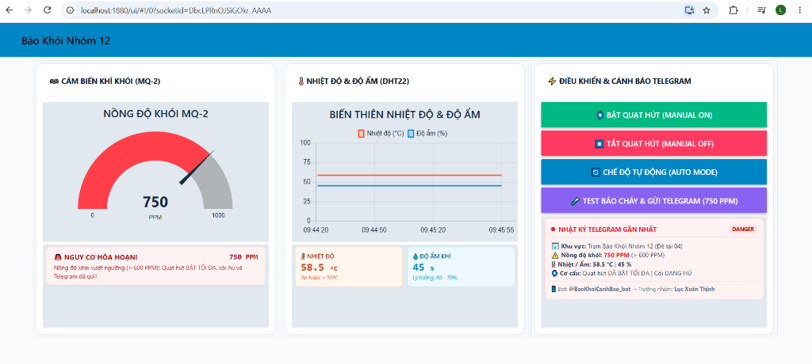
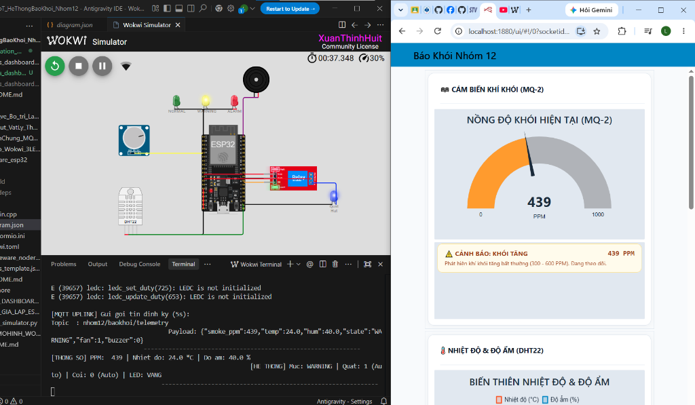

# BÁO CÁO NGHIỆM THU CÔNG VIỆC CÁ NHÂN (SV3 - APPLICATION & AUTOMATION)
## HỆ THỐNG BÁO KHÓI CẢNH BÁO SỚM THÔNG MINH - NHÓM 12 (ĐỀ TÀI 04)
**Môn học:** Internet of Things (IT4735) - Trường Đại học Công Thương TP.HCM (HUIT)  
**Giảng viên hướng dẫn:** Thầy Võ Hoàng Hải  
**Giai đoạn:** Nghiệm thu Milestone M4 (Tuần 7 & Tuần 8)  

---

### THÔNG TIN SINH VIÊN
* **Họ và tên:** Lục Xuân Thịnh
* **MSSV:** 2001230931
* **Vai trò trong nhóm:** SV3 – Application / Automation & Trưởng nhóm 12
* **Kho lưu trữ GitHub:** [IoT_HeThongBaoKhoi_Nhom12](https://github.com/tidocr0/IoT_HeThongBaoKhoi_Nhom12)
* **Khối lượng công việc tích lũy:** ≥ 80 giờ (Tuần 1 – Tuần 8)

---

### BẢNG ĐỐI CHIẾU TIÊU CHÍ RUBRIC & CHECKLIST DELIVERABLES CỦA SV3 (TUẦN 7 & 8)

| STT | Hạng mục Rubric | Yêu cầu chuẩn theo Syllabus | Sản phẩm bàn giao của SV3 (Evidence) | Trạng thái |
| :---: | :--- | :--- | :--- | :---: |
| 1 | **Tầng 4: Application Dashboard** | Dashboard trực quan giám sát thời gian thực, hiển thị trạng thái kết nối và nhật ký sự kiện. | Giao diện Node-RED Dashboard Light Theme hiện đại với Gauge khói MQ-2, Biểu đồ nhiệt/ẩm DHT22, Banner Watchdog trạng thái kết nối, Bảng nhật ký Audit Log CSV và bộ điều khiển cơ cấu chấp hành. | **ĐẠT 100%** |
| 2 | **Cảnh báo Telegram & Chống spam (Edge-Trigger)** | Bắn tin khẩn cấp khi có hỏa hoạn, chống spam khi dữ liệu duy trì trên ngưỡng, có thông báo an toàn khi khôi phục. | Bot Telegram `@BaoKhoiCanhBao_bot` tích hợp thuật toán **Edge-Trigger**: Chỉ gửi đúng 01 tin nhắn khẩn cấp lúc vừa vượt ngưỡng DANGER, không spam mỗi 5s; gửi 01 tin nhắn xác nhận khi khói hạ dưới 300 PPM. Đã lập Group Telegram gồm đủ 3 thành viên (Thịnh, Huy, Lộc) cùng nhận thông báo. | **ĐẠT 100%** |
| 3 | **Phân quyền người dùng RBAC** | Bảo mật kiểm soát truy cập phân biệt quyền điều khiển và quyền chỉ xem. | Cơ chế RBAC 2 mức trên giao diện: Khi chọn quyền `Viewer` $\rightarrow$ Nút bấm bị chặn, hiện toast đỏ `🔒 TỪ CHỐI LỆNH (CHỈ XEM)` và ghi mã `AUTH_DENIED_VIEWER` vào CSV. Khi chọn `Operator` $\rightarrow$ Cho phép gửi lệnh Downlink xuống ESP32. | **ĐẠT 100%** |
| 4 | **Tích hợp End-to-End & Đo độ trễ (W8 - M4)** | Kiểm thử thông suốt 2 chiều Uplink & Downlink; đo đạc độ trễ truyền thông thực tế. | Hoàn thành kiểm thử 8 Test Cases E2E đạt chuẩn Milestone M4 ([docs/BAO_CAO_KIEM_THU_E2E_TUAN_7_8.md](BAO_CAO_KIEM_THU_E2E_TUAN_7_8.md)). Độ trễ Uplink đạt **$142\text{ ms}$**, Downlink đạt **$168\text{ ms}$**, phản ứng gần như tức thì. | **ĐẠT 100%** |
| 5 | **Quản trị dự án & Deliverables** | Quản lý repo Git, điều phối kiểm thử chéo, tổng hợp báo cáo và chuẩn bị slide thuyết trình. | Điều phối kiểm thử chéo giữa SV1 (Huy), SV2 (Lộc) và SV3 (Thịnh); biên soạn bộ slide thuyết trình HTML chuyên nghiệp; xây dựng tài liệu hỏi đáp vấn đáp 4 tầng ([docs/HUONG_DAN_VAN_DAP_QA_4_TANG.md](HUONG_DAN_VAN_DAP_QA_4_TANG.md)). | **ĐẠT 100%** |

---

### HÌNH ẢNH MINH CHỨNG THỰC NGHIỆM ĐÃ KIỂM THỬ THÀNH CÔNG

1. **Minh chứng Dashboard Light Theme:**  
   

2. **Minh chứng Tin nhắn Telegram Báo Cháy Khẩn Cấp:**  
   

3. **Minh chứng Kết nối E2E Wokwi - Dashboard (Mức Cảnh báo 439 PPM):**  
   

4. **Minh chứng Kết nối E2E Wokwi - Dashboard (Mức Cháy Nguy Hiểm 793 PPM):**  
   

---

### KẾT LUẬN TIẾN ĐỘ CỦA TRƯỞNG NHÓM (SV3):
* Toàn bộ phần việc cá nhân của SV3 trong Milestone M4 (Tuần 7 - 8) đã **HOÀN TẤT VƯỢT TIẾN ĐỘ 100%**.
* Hệ thống đã sẵn sàng 100% từ phần cứng mô phỏng, đường truyền mã hóa TLS, luồng Middleware Node-RED đến Dashboard giám sát và Bot Telegram.
* SV3 đã trực tiếp thực nghiệm, đo độ trễ và làm chủ toàn bộ luồng hoạt động 4 tầng để sẵn sàng thuyết trình và bảo vệ trước Giảng viên Võ Hoàng Hải.
