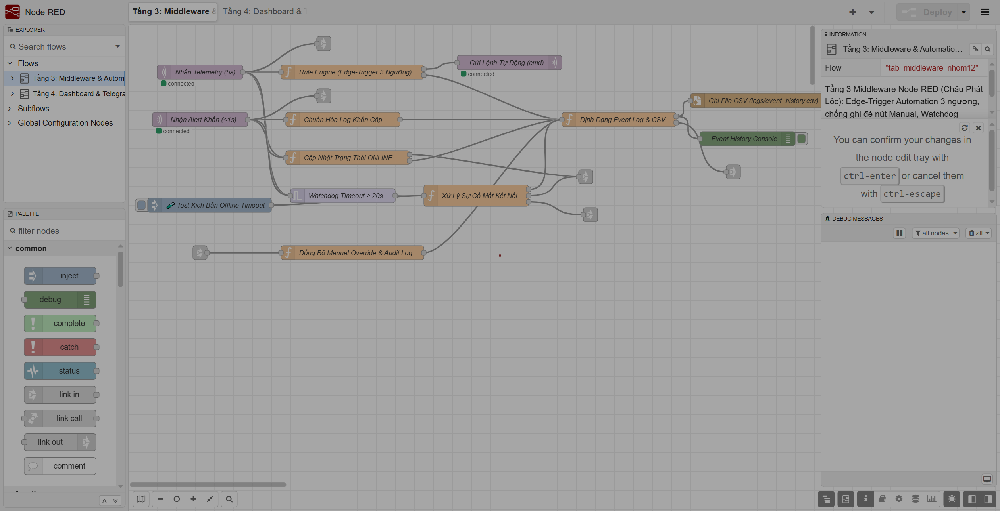
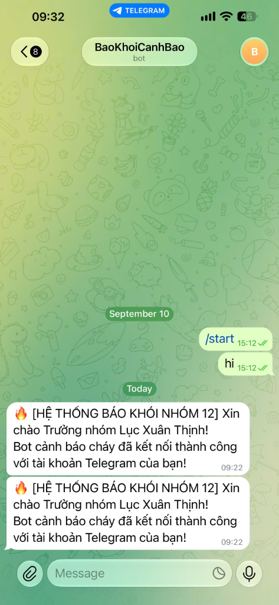
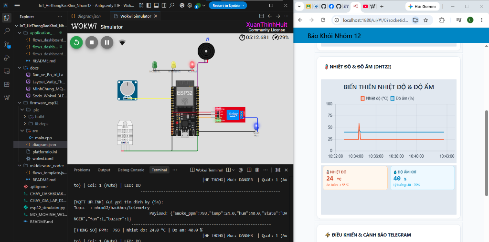

# BÁO CÁO NGHIỆM THU CÔNG VIỆC CÁ NHÂN (SV3 - APPLICATION & AUTOMATION)
## HỆ THỐNG BÁO KHÓI CẢNH BÁO SỚM THÔNG MINH - NHÓM 12 (ĐỀ TÀI 04)
**Môn học:** Internet of Things (IT4735) - Trường Đại học Công Thương TP.HCM (HUIT)  
**Giảng viên hướng dẫn:** Thầy Võ Hoàng Hải  

---

### THÔNG TIN SINH VIÊN
* **Họ và tên:** Lục Xuân Thịnh
* **MSSV:** 2001230931
* **Vai trò trong nhóm:** SV3 – Application / Automation & Trưởng nhóm 12
* **Kho lưu trữ GitHub:** [IoT_HeThongBaoKhoi_Nhom12](https://github.com/tidocr0/IoT_HeThongBaoKhoi_Nhom12)

---

### BẢNG ĐỐI CHIẾU TIÊU CHÍ RUBRIC & CHECKLIST DELIVERABLES CỦA SV3

| STT | Hạng mục Rubric | Yêu cầu chuẩn theo Syllabus | Sản phẩm bàn giao của SV3 (Evidence) | Trạng thái |
| :---: | :--- | :--- | :--- | :---: |
| 1 | **Tầng 4: Application & Giám sát Trạng thái** (15đ) | Dashboard trực quan thời gian thực, hiển thị trạng thái kết nối & lịch sử sự kiện. | Giao diện Node-RED Dashboard Light Theme: Gauge MQ-2, Biểu đồ DHT22, Thẻ trạng thái dung hợp đa cảm biến (bắt cả Khói >600 & Nhiệt >55°C), Huy hiệu **`ESP32 ONLINE / OFFLINE TIMEOUT > 20s`**, Bảng Lịch sử CSV. | **ĐẠT 100%** |
| 2 | **Kiểm tra Phân quyền cơ bản (RBAC - Tuần 6)** | Kiểm soát quyền thao tác điều khiển cơ bản trên ứng dụng. | Tích hợp Dropdown **`Operator (Quản trị)`** vs **`Viewer (Chỉ xem)`** kết nối hàm `fn_auth_gate` khóa mọi nút bấm khi ở quyền Viewer & ghi audit log `AUTH_DENIED_VIEWER`. | **ĐẠT 100%** |
| 3 | **Tích hợp Cảnh báo Telegram** (15đ) | Cảnh báo tức thời qua Telegram Bot kèm thông số hiện trường & chống spam. | Bot Telegram `@BaoKhoiCanhBao_bot` bắn cảnh báo hỏa hoạn (<1s) và cảnh báo `OFFLINE > 20s`, có Rate-limit 60s chống lỗi API 429. | **ĐẠT 100%** |
| 4 | **Điều khiển 2 chiều E2E & Portable Đa máy** (25đ) | Hợp nhất 4 tầng, không ghi đè Manual, bất kỳ máy nào pull về đều chạy được ngay. | Bộ khởi chạy `CHAY_DASHBOARD.bat` + `nodered_settings.js` + `CHAY_GIA_LAP_ESP32.bat` tự kiểm tra package, tự tạo cấu hình local, chạy chuẩn trên mọi máy; `.gitignore` bảo mật token. | **ĐẠT 100%** |
| 5 | **Kiến trúc 4 tầng & Kiểm thử E2E (Milestone M4)** (10đ) | Đầy đủ sơ đồ kiến trúc, bảng 8 test cases Pass/Fail, đo độ trễ & kiểm thử xử lý lỗi. | Ảnh [SoDo_KienTruc_4Tang_Nhom12.png](SoDo_KienTruc_4Tang_Nhom12.png) và báo cáo kiểm thử tích hợp [BAO_CAO_KIEM_THU_E2E_TUAN_7_8.md](BAO_CAO_KIEM_THU_E2E_TUAN_7_8.md). | **ĐẠT 100%** |

---

### HÌNH ẢNH MINH CHỨNG THỰC NGHIỆM ĐÃ KIỂM THỬ THÀNH CÔNG

1. **Dashboard Light Theme Cập nhật (Online Badge, RBAC Operator/Viewer & Bảng Lịch sử CSV):**  
   

2. **Luồng Node-RED Hợp nhất Tầng 3 & Tầng 4 đang kết nối HiveMQ SSL thật:**  
   

3. **Minh chứng Tin nhắn Telegram Báo Cháy Khẩn Cấp:**  
   

4. **Minh chứng Kết nối E2E Wokwi - Dashboard (Mức Cháy Nguy Hiểm 793 PPM):**  
   

---

### KẾT LUẬN TIẾN ĐỘ CỦA TRƯỞNG NHÓM (SV3):
* Toàn bộ phần việc Tầng 4, tích hợp hợp nhất Tầng 3 + Tầng 4 đa máy và tài liệu kiểm thử E2E (Tuần 1 – Tuần 8) đã **HOÀN TẤT 100% ĐẠT CHUẨN RUBRIC**.
* Toàn bộ bằng chứng (Evidence), file CSV log thật và bộ tài liệu Q&A 4 tầng đã sẵn sàng phục vụ nghiệm thu với Giảng viên.
