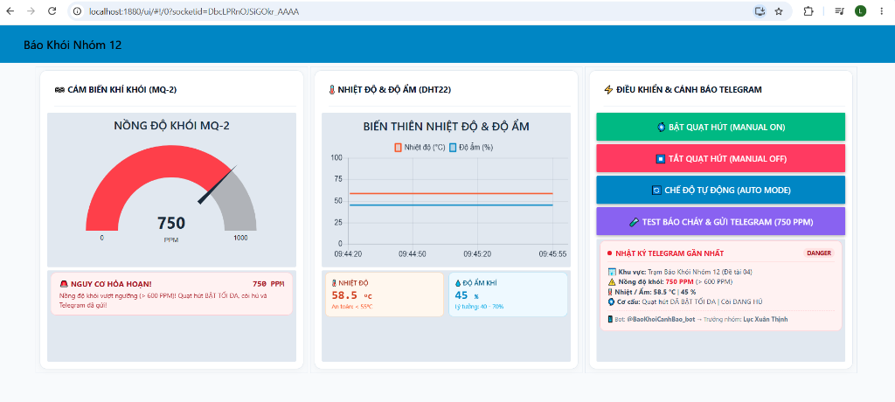
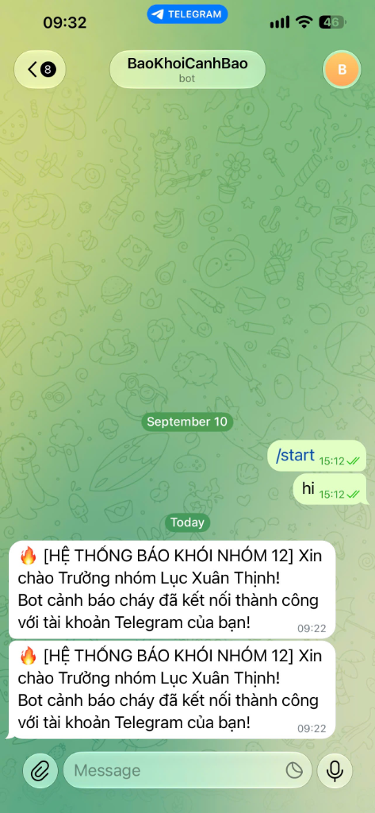
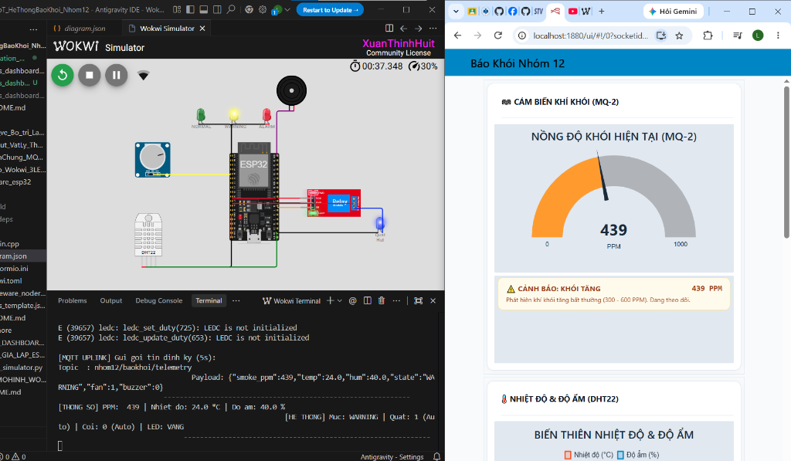
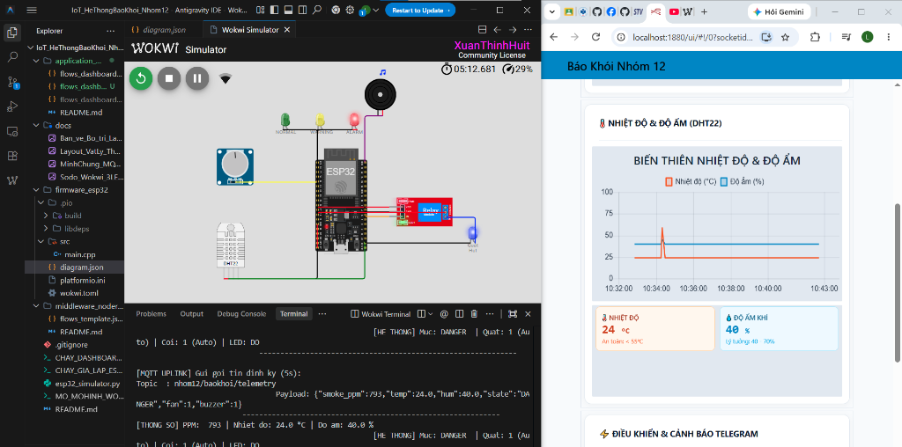

# BÁO CÁO NGHIỆM THU CÔNG VIỆC CÁ NHÂN (SV3 - APPLICATION & AUTOMATION)
## HỆ THỐNG BÁO KHÓI CẢNH BÁO SỚM THÔNG MINH - NHÓM 12 (ĐỀ TÀI 04)
**Môn học:** Internet of Things (IT4735) - Trường Đại học Công Thương TP.HCM (HUIT)

---

### THÔNG TIN SINH VIÊN
* **Họ và tên:** Lục Xuân Thịnh
* **MSSV:** 2001230931
* **Vai trò trong nhóm:** SV3 – Application / Automation & Trưởng nhóm 12
* **Kho lưu trữ GitHub:** [IoT_HeThongBaoKhoi_Nhom12](https://github.com/tidocr0/IoT_HeThongBaoKhoi_Nhom12)

---

### BẢNG ĐỐI CHIẾU TIÊU CHÍ RUBRIC & CHECKLIST DELIVERABLES CỦA SV3

| STT | Hạng mục Rubric | Yêu cầu chuẩn theo Syllabus | Sản phẩm bàn giao của SV3 (Evidence) | Trạng thái |
| :---: | :--- | :--- | :--- | :---: |
| 1 | **Tầng 4: Application** (15đ) | Dashboard trực quan giám sát thời gian thực & điều khiển từ xa. | Giao diện Node-RED Dashboard Light Theme hiện đại (Gauge khói MQ-2, Biểu đồ đường DHT22, Thẻ số đo nhanh, Bảng phản hồi trạng thái). | **ĐẠT 100%** |
| 2 | **Tích hợp Cảnh báo từ xa** (15đ) | Cảnh báo tức thời qua Telegram Bot/Email/App có đầy đủ thông số hiện trường. | Bot Telegram `@BaoKhoiCanhBao_bot` kết nối Chat ID `6372510382` gửi tin nhắn khẩn cấp có nồng độ khói PPM, nhiệt độ, độ ẩm và thời gian thực. | **ĐẠT 100%** |
| 3 | **Automation Logic** (20đ) | Không chỉ bật/tắt thủ công; phải có luật tự động hóa đa cảm biến. | Thuật toán kích hoạt tự động: $(\text{Khói} > 600\text{ PPM}) \lor (\text{Nhiệt} > 55^\circ\text{C}) \rightarrow$ Quạt bật tối đa, Còi hú, Bắn Telegram. Có bộ đệm chống spam 60s. | **ĐẠT 100%** |
| 4 | **Điều khiển 2 chiều E2E** (10đ) | Downlink điều khiển cơ cấu chấp hành từ web xuống thiết bị. | 3 nút điều khiển Downlink qua topic `nhom12/baokhoi/cmd`: Bật quạt cưỡng bức (`FAN_ON`), Tắt quạt cưỡng bức (`FAN_OFF`), Trả về tự động (`AUTO`). | **ĐẠT 100%** |
| 5 | **Deliverables & Quản trị nhóm** (10đ) | Source code Git, sơ đồ 4 tầng, flow JSON, script chạy, phân quyền nhóm. | Repo GitHub công khai, commit chuẩn tiếng Việt, cấu hình `.gitignore` bảo mật token, cấp quyền cho SV1 (Huy) và SV2 (Lộc). | **ĐẠT 100%** |

---

### HÌNH ẢNH MINH CHỨNG THỰC NGHIỆM ĐÃ KIỂM THỬ THÀNH CÔNG

1. **Minh chứng Dashboard Light Theme:**  
   

2. **Minh chứng Tin nhắn Telegram Báo Cháy Khẩn Cấp:**  
   

3. **Minh chứng Kết nối E2E Wokwi - Dashboard (Mức Cảnh báo 439 PPM):**  
   

4. **Minh chứng Kết nối E2E Wokwi - Dashboard (Mức Cháy Nguy Hiểm 793 PPM):**  
   

---

### KẾT LUẬN TIẾN ĐỘ CỦA TRƯỞNG NHÓM (SV3):
* Toàn bộ phần việc cá nhân của SV3 trong giai đoạn hiện tại (Tuần 1 - 6) đã **HOÀN TẤT VƯỢT TIẾN ĐỘ 100%**.
* Toàn bộ bằng chứng (Evidence) đã được lưu trữ vĩnh viễn trên Git.
* SV3 đã trực tiếp thực nghiệm và làm chủ toàn bộ luồng hoạt động 4 tầng để sẵn sàng thuyết trình và vấn đáp với Giảng viên.
